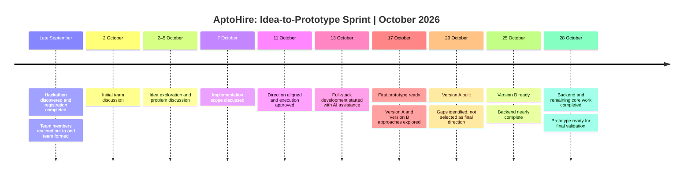
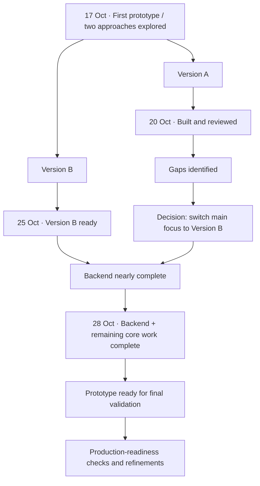
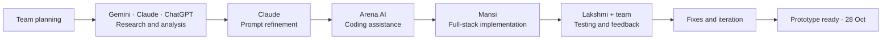

# AptoHire | From Idea to Working Prototype
**Three-person founding team · AI-assisted full-stack development · Human-led testing**

<strong>Execution snapshot</strong>

- **Team formed:** Late September 2026
- **Idea and scope alignment:** 2–11 October
- **Development started:** 13 October
- **First prototype:** 17 October
- **Version A built:** 20 October — reviewed, but not selected due to gaps
- **Version B ready:** 25 October — backend nearly complete
- **End-to-end prototype ready:** 28 October — backend and remaining core work completed
- **Current stage:** Prototype complete; production readiness is the next step, expected in the coming days, subject to final checks.

## 1. Timeline — the key milestones

<strong>Milestone details</strong>

| Date | Milestone | Outcome |
|---|---|---|
| Late September | Hackathon discovery, registration and outreach | Three-person remote founding team formed |
| 2–5 October | Idea discussion | Initial concept and execution approach explored |
| 7 October | Scope meeting | Features to implement discussed |
| 11 October | Direction meeting | Team aligned and agreed to start |
| 13 October | Development began | AI-assisted full-stack execution started |
| 17 October | First prototype | Initial version available; two approaches considered |
| 20 October | Version A built | Reviewed, but gaps meant it was not selected |
| 25 October | Version B ready | Backend was nearly complete |
| 28 October | Core prototype complete | Backend and remaining core work completed |

## 2. The version decision

**Why switch?** Version A was built by 20 October, but the team felt it had shortcomings. Rather than settle for it, the team moved its focus to Version B. Version B was ready by 25 October, with the backend nearly complete; by 28 October, the backend and remaining core work were complete.

## 3. Founding team & execution ownership

| Team member | Role | Main contribution |
|---|---|---|
| **Ravi Prakash** | Founder | Proposed the original idea and contributed to team discussions. |
| **Mansi Kumawat** | Co-founder & Team Lead | Coordinated the team and handled documentation plus full-stack development. |
| **Laxminarayan** | Co-founder | Provided technical guidance, contributed UI/technology inputs, and helped significantly with testing. |

*The team collaborated on planning, product decisions and feedback throughout the sprint.*

## 4. AI-assisted execution workflow

**Execution model:** AI tools accelerated research, planning, prompt creation and coding assistance. The team stayed involved in implementation decisions, manual testing, review and iteration. This was AI-assisted execution—not a fully autonomous build.

## 5. Current status & next step

<strong>Where the product stands</strong>

- **Prototype:** Core work completed by 28 October 2026.
- **Testing:** Team members contributed to manual testing and feedback.
- **Next milestone:** Prepare for production readiness in the coming days, subject to final QA, security/privacy checks, deployment configuration and validation of all critical user flows.
- **Important distinction:** “Prototype complete” does not automatically mean “production ready.” The team will confirm production readiness after these checks pass.

### What this sprint demonstrates

**Fast iteration. Clear team alignment. AI-assisted full-stack execution. Human testing. Evidence-led version selection.**

AptoHire moved from team formation and early-October planning to a complete core prototype by 28 October—roughly a two-week development sprint after coding began on 13 October.

---

*This document records the timeline and responsibilities as provided by the team. Update milestone dates or readiness status as further validation is completed.*
