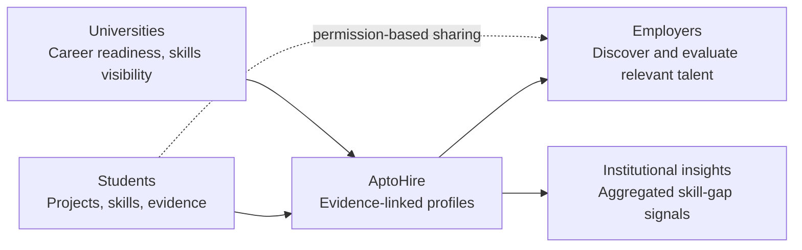
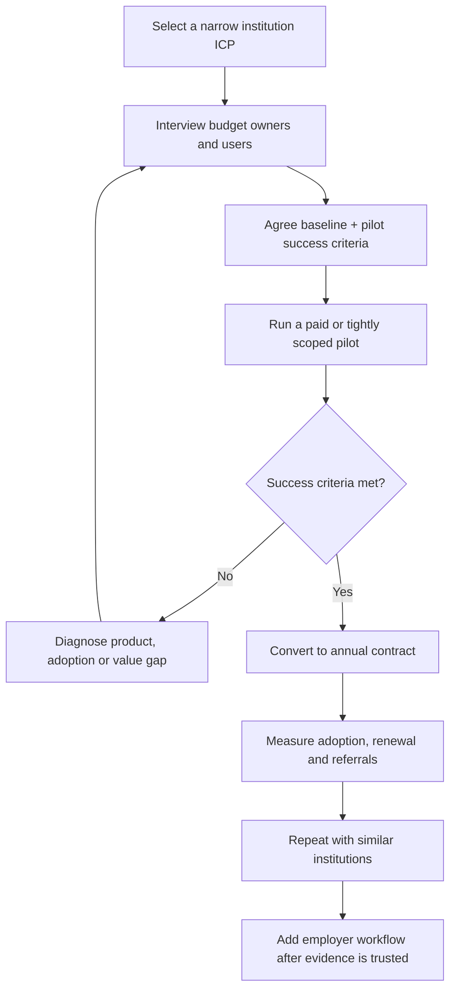

# AptoHire
## Market Potential & Startup Viability
**Investor / startup competition briefing · India-first · University-first go-to-market**

> **The investment thesis:** AptoHire can become an evidence layer between education and employment—helping institutions make student capabilities more visible and helping employers evaluate skills beyond a résumé. The opportunity is meaningful, but the business becomes investable only if university buyers pay for a measurable outcome, users trust the evidence and disclosure model, and pilots convert into repeatable deployments.

<details open>
<summary><strong>Executive verdict — open to read</strong></summary>

**Verdict: Promising problem, plausible business model, validation still required.**

- **Problem significance:** Strong. India has a large higher-education base, while employer readiness and employability remain important concerns.
- **Market potential:** Potentially substantial, but the addressable revenue depends on the number of institutions willing and able to pay—not the total number of students alone.
- **Differentiation:** Potentially compelling if AptoHire combines evidence-linked student profiles, permission-based disclosure, institutional skill insights and employer discovery in a trustworthy workflow.
- **Commercial viability:** Unproven. No verified paying customers, signed pilots, retention data, conversion data or survey response export has been provided for this assessment.
- **Current readiness:** Mixed functional/prototype state, based on the product context supplied. Production readiness must be demonstrated feature by feature.
- **Best next move:** Sell a narrow, measurable university pilot before expanding into a broad multi-sided marketplace.

</details>

---

## 1. The problem worth solving

### The gap

Students often present themselves through grades, certificates, résumés and self-reported skills. These signals may not make practical capability easy to inspect or compare. Universities need evidence that helps them support career readiness and communicate outcomes. Employers want reliable signals about what early-career candidates can actually do.

AptoHire’s proposed role is to connect those needs with **verifiable evidence, user-controlled sharing and useful institutional insights**.



<details>
<summary><strong>Why this matters to a judge or investor</strong></summary>

The opportunity is not simply “another job portal” or “AI matching.” The defensible product hypothesis is a trusted workflow that makes capability easier to demonstrate and evaluate. The product must prove that its evidence is more useful than existing CVs, portfolios, campus placement systems, assessments and professional networks—and that institutions will pay to use it.

</details>

### Evidence that the problem is large enough to investigate

- India’s Ministry of Education reported **4.50 crore (45.0 million) higher-education enrolments in 2023–24**, up from 3.42 crore in 2014–15. The same government release reports 64,756 registered higher-education institutions for the 2023–24 survey context. These figures show scale; they do **not** mean all students or institutions are AptoHire customers. [Source: Ministry of Education / PIB, AISHE 2022–23 & 2023–24 release](https://www.pib.gov.in/PressReleasePage.aspx?PRID=2282525&lang=1&reg=48).
- Mercer | Mettl’s *India’s Graduate Skill Index 2025* reports that 42.6% of Indian graduates who applied for jobs were assessed as overall employable in its analysis. It analysed more than one million students across 2,700+ campuses. This is a third-party study result, not a universal measure of every graduate and not proof that AptoHire will improve employability. [Source: Mercer | Mettl](https://www.mercer.com/insights/talent-and-transformation/talent-assessment/indias-graduate-skill-index-2025/).

**Interpretation:** The market has a large population and a credible skills-signalling problem. AptoHire still needs customer discovery to prove which specific workflow is painful enough to earn a budget.

---

## 2. Who pays first?

### Beachhead customer: universities and colleges

Start with a specific institution segment rather than marketing to every student, university and employer at once.

| Segment | Job to be done | Potential buyer | Why start / why wait |
|---|---|---|---|
| Universities and colleges | Make student project/skill evidence easier to organise, review and use in career-readiness workflows | Placement head, career-services lead, dean, department head, institution leadership | **First beachhead.** One institutional relationship can bring a defined student cohort and a measurable pilot. |
| Students | Build a credible, shareable record of skills and projects | Often user, not initial payer | Essential supply side; reduce friction and make value visible before asking for payment. |
| Employers | Find and assess candidates using relevant evidence | Talent acquisition, campus hiring, business/team leads | Expand after evidence quality, permission controls and candidate supply are demonstrated. |
| Training providers / ecosystem partners | Track project evidence and learner outcomes | Provider leadership | Later channel or adjacent segment; avoid premature scope expansion. |

<details>
<summary><strong>Ideal first customer profile (ICP)</strong></summary>

A university or college with a motivated placement/career-services champion, a manageable pilot cohort, an identifiable employability or employer-engagement problem, authority to run a pilot, and willingness to agree on baseline metrics. Prefer an institution where a small deployment can be completed without a long, complex procurement process.

**Disqualifiers:** no internal owner, no access to a pilot cohort, no agreed success metric, no lawful basis/permission for required data, or an expectation that AptoHire guarantees placements.

</details>

---

## 3. Market potential — transparent, bottom-up model

A credible investor conversation separates **the overall education landscape** from the portion AptoHire can reach and the portion it can realistically win.

### Illustrative institution-based scenario

The following is a **planning model, not a published market-size estimate**. Institution counts in the targetable market and annual contract value are assumptions to test through sales discovery.

| Layer | Planning assumption | Calculation | Illustrative annual revenue pool |
|---|---:|---:|---:|
| Broad context | 64,756 registered HEIs in the AISHE 2023–24 survey context | Not multiplied by price; not all are buyers | **Not a TAM revenue figure** |
| **TAM proxy** | 10,000 institutions could eventually fit the product; ₹5 lakh average annual contract value | 10,000 × ₹5,00,000 | **₹500 crore/year** |
| **SAM proxy** | 2,000 institutions fit the initial target profile and are serviceable; ₹5 lakh/year | 2,000 × ₹5,00,000 | **₹100 crore/year** |
| **3–5 year SOM scenario** | 100 paying institutions at ₹5 lakh/year | 100 × ₹5,00,000 | **₹5 crore ARR** |

> **Important:** 10,000, 2,000, 100 and ₹5 lakh are explicit modelling assumptions—not verified counts, quotes, signed prices or forecasts. Replace them with a segmented institution list, validated willingness-to-pay and actual sales conversion data. The TAM proxy is not the total Indian recruitment market.

### How to make the estimate investor-grade

1. Build a named list of target institutions by type, geography, student cohort size, placement maturity and procurement readiness.
2. Interview budget owners—not only students—to identify the problem, current spend, buying process and procurement cycle.
3. Test 2–3 price points and packaging options with actual buyers.
4. Separate one-time implementation fees from recurring subscription revenue.
5. Track qualified pipeline, paid-pilot conversion, renewal and expansion.
6. Recalculate TAM/SAM/SOM from evidence every quarter.

<details>
<summary><strong>Alternative upside — employer revenue (not included in the base model)</strong></summary>

A later employer tier could charge for qualified candidate discovery, workflow tools or hiring analytics. Do not add this to the base market-size claim until pricing, demand, product delivery and legal/contract constraints are validated. Avoid double-counting the same institution, student or employer spend across multiple market layers.

</details>

---

## 4. Product proposition and potential advantage

### Proposed value proposition

**For universities:** make student capability evidence easier to organise and use in career-readiness workflows.

**For students:** present projects and skills with clearer supporting evidence and control over what is shared.

**For employers:** inspect relevant candidate evidence and discover talent through a structured workflow.

### What could differentiate AptoHire?

| Capability hypothesis | User value | What must be proven |
|---|---|---|
| Evidence-linked skill profiles | Less reliance on unsubstantiated skill claims | Reviewers find evidence more useful than a CV alone |
| User-controlled identity disclosure | Greater trust and control over sharing | Consent and permissions work correctly and are understandable |
| University skill insights | Better visibility into cohort strengths and gaps | Insights are accurate, actionable and privacy-safe |
| Employer discovery | Easier identification of relevant candidates | Employers engage, shortlist and return |
| Integrated student–university–employer workflow | Less fragmented coordination | Institutions and employers use the workflow repeatedly |

**Do not claim a moat merely because the product uses AI.** A durable advantage could emerge from trusted evidence standards, integrations, institutional workflow adoption, quality data generated with appropriate permissions, and repeatable distribution. These are hypotheses—not established moats.

### Competitive reality

AptoHire competes with existing behaviours as much as with software: CVs, LinkedIn-style profiles, job portals, applicant-tracking systems, campus placement tools, assessments, portfolios and spreadsheets.

Its winning question is:

> **Can AptoHire improve a specific decision or workflow enough that an institution will pay, a student will participate, and an employer will trust the evidence?**

---

## 5. Business model and monetisation

### Recommended first model: institution-led B2B SaaS

| Revenue stream | Role in strategy | Status |
|---|---|---|
| Annual university/institution subscription | Primary initial revenue hypothesis | Validate willingness-to-pay |
| Paid pilot / implementation | Reduce adoption risk and fund onboarding | Test scope and pricing |
| Employer subscription or hiring workflow fees | Potential expansion after supply and evidence quality improve | Not assumed in base model |
| Optional analytics or integrations | Potential premium tier | Only after clear buyer value and privacy review |

### Pricing experiment — not a published price list

Test three offers with buyers, adjusting scope rather than simply discounting:

- **Pilot:** defined cohort, limited duration, agreed onboarding and success metrics.
- **Core institution plan:** recurring access for an agreed cohort and workflow.
- **Institution-plus plan:** larger cohort, additional workflows, integrations or support.

Do not finalise pricing based only on competitor list prices. Price according to measurable value, implementation burden, support cost, institution budget and procurement friction.

### Illustrative unit economics to measure

```text
Gross profit per institution
= Annual contract revenue − direct delivery and support cost

Gross margin
= Gross profit ÷ annual contract revenue

CAC (customer acquisition cost)
= Sales + marketing acquisition cost ÷ new paying institutions

CAC payback (months)
= CAC ÷ monthly gross profit per new institution

Net revenue retention
= Starting recurring revenue + expansion − contraction − churn
  ------------------------------------------------------------
                    Starting recurring revenue
```

The current financial model is assumption-driven. Treat its outputs as scenarios, not actual performance. Investor readiness requires real costs, contract values, sales cycle, renewal evidence and cash-flow reconciliation.

---

## 6. Go-to-market: prove one repeatable motion



### First 90 days: validation plan

| Period | Priority | Required output |
|---|---|---|
| Days 1–30 | Customer discovery | 15–20 structured conversations across placement leaders, students and recruiters; at least 5 conversations with actual budget owners |
| Days 31–60 | Pilot design and willingness-to-pay | 2–3 pilot proposals, a named champion, written scope, data/consent review and agreed baseline |
| Days 61–90 | Deliver and evaluate | At least one live pilot if access and approvals permit; activation, repeat usage, reviewer usefulness, operational effort and conversion intent measured |

These are **targets**, not completed achievements. Do not represent planned interviews or pilots as traction.

### Pilot scorecard

Choose targets with the institution before launch. Illustrative metrics:

- Activation: percentage of invited students who complete a meaningful profile/evidence action.
- Evidence completeness: percentage of profiles meeting an agreed evidence standard.
- Reviewer utility: percentage of reviewers who report the evidence improved their evaluation, supported by a defined survey or task.
- Employer engagement: relevant profiles viewed, shortlists or follow-up actions—only if employer access is part of the pilot.
- Time saved: measured against a documented baseline, not recalled impressions alone.
- Conversion: paid continuation, renewal intent or signed commercial next step.
- Trust guardrails: consent comprehension, access errors, complaints and security/privacy incidents.

Do not use placement rate as the only short pilot outcome; it is influenced by many factors outside the product.

---

## 7. Product, technical and operational viability

The product context supplied indicates a **mixed functional/prototype state**. The architecture and requirements documents are design artefacts; they do not by themselves prove production readiness.

### Viability gates

- [ ] Core student workflow works end-to-end with test users.
- [ ] Institution administrator workflow is tested with realistic permissions.
- [ ] Employer access is limited to the approved purpose and user-authorised information.
- [ ] Role-based access controls are enforced server-side/database-side, not only hidden in the UI.
- [ ] Consent, revocation, deletion and retention behaviour is documented and tested.
- [ ] AI outputs are evaluated for accuracy, consistency, bias risks and failure handling.
- [ ] Model/vendor costs and rate limits are measured.
- [ ] Monitoring, backups, incident response and recovery are tested.
- [ ] Product claims accurately distinguish prototype, beta and production features.

### AI strategy

Use AI where it improves a measurable workflow—for example, helping structure evidence or support discovery—not as an opaque authority over a person’s employability. Provide transparency, user correction paths and human review for consequential decisions. Do not allow a single model score to determine a student’s prospects.

### Trust is part of the product

AptoHire’s handling of student identity, assessment evidence and employer access could create real risks. Data minimisation, clear consent, least privilege, secure integration, appropriate retention and legal review are requirements for adoption—not optional enterprise features.

---

## 8. Key risks and mitigations

| Risk | Why it matters | Mitigation / early warning |
|---|---|---|
| Universities like the idea but will not pay | Interest is not purchasing intent | Ask budget owners about current spend, procurement and a paid pilot |
| Long institutional sales cycles | Delays revenue and raises burn | Start with a narrow, champion-led pilot and a clear decision date |
| Cold-start marketplace | Employers need relevant supply; students need visible opportunities | Begin institution-first and a bounded cohort; avoid claiming marketplace liquidity |
| Low student completion | Evidence profiles only work if data is useful and current | Minimise onboarding, provide clear user benefit and measure activation |
| Weak or unverifiable evidence | Employer trust collapses | Define evidence standards, provenance, review and correction workflows |
| Bias or misleading AI assessments | Harm to users and reputational/legal exposure | Test validity, explain limits, provide human review and appeal/correction |
| Privacy or security failure | Student and institutional trust at risk | Minimise data, enforce permissions, audit access and test incident response |
| Incumbents copy features | Feature-level differentiation is fragile | Build workflow adoption, institutional relationships, trusted evidence and measurable outcomes |
| Costs exceed contract value | SaaS margins deteriorate | Measure support, implementation, model and integration cost per institution |
| Overclaiming traction or market size | Damages credibility with judges/investors | Label assumptions, cite sources and report verified evidence only |

---

## 9. Startup viability scorecard

This is a qualitative assessment based on the information available—not an external rating or investment recommendation.

| Dimension | Assessment | Reason |
|---|---|---|
| Problem importance | **Promising** | Large education-to-employment context and credible skills-signalling challenge |
| Market size | **Potentially attractive** | Large underlying ecosystem; serviceable paying segment remains to be measured |
| Product differentiation | **Hypothesis to validate** | Evidence + permission + institution workflow could be meaningful if users prefer it |
| Technical feasibility | **Plausible, not fully verified** | A bounded MVP is feasible; production reliability and security need proof |
| Willingness to pay | **Unknown / critical risk** | No verified paid contracts or pricing validation provided |
| Go-to-market | **Plausible but execution-heavy** | Institution-first narrows the initial motion, but procurement can be slow |
| Network effects | **Possible later** | Require recurring institutional use, trusted evidence and employer participation |
| Financial viability | **Not yet demonstrated** | Model assumptions are not actuals; CAC, margin, runway and renewal are unverified |
| Overall | **Proceed to validation, not scale-up claims** | Run a measurable pilot and secure evidence of payment/renewal before broad expansion |

---

## 10. What judges and investors may ask

<details>
<summary><strong>“How large is your market?”</strong></summary>

“We are sizing from the institution side rather than treating every student as a paying customer. Our initial scenario models 2,000 serviceable institutions at an assumed ₹5 lakh annual contract value, or ₹100 crore in annual serviceable revenue. Both the targetable institution count and price are assumptions we are validating. We will replace them with a segmented account list and paid-pilot evidence.”

</details>

<details>
<summary><strong>“Why will a university pay for this?”</strong></summary>

“That is our most important commercial hypothesis. We are testing whether evidence-linked skill profiles and structured workflows improve a university’s career-readiness or employer-engagement process enough to justify a budget. We will measure adoption, reviewer usefulness, operational effort and paid conversion rather than relying on positive feedback alone.”

</details>

<details>
<summary><strong>“Why can’t LinkedIn or an existing campus platform do this?”</strong></summary>

“Existing platforms are strong alternatives, and we do not claim they cannot add similar features. Our hypothesis is that AptoHire can focus on evidence provenance, permission-based disclosure and institution-to-employer workflows. We must prove this produces better outcomes in a specific use case and is not just a feature difference.”

</details>

<details>
<summary><strong>“What traction do you have?”</strong></summary>

“Traction must be reported using verified numbers: live institutions, active students, evidence completion, employer usage, paid pilots, revenue and renewals. Those verified figures have not been supplied for this assessment, so we will not invent them. Our next milestone is a measurable institutional pilot with a clear commercial decision.”

</details>

<details>
<summary><strong>“What is the moat?”</strong></summary>

“We do not consider AI alone a moat. The potential advantage is a trusted evidence standard embedded in institutional workflows, supported by integrations and permissioned data that users choose to share. That advantage only becomes defensible if adoption, data quality and repeat usage are demonstrated.”

</details>

<details>
<summary><strong>“What will funding achieve?”</strong></summary>

“Any funding ask should be tied to specific milestones: completing production-readiness and privacy controls, running institution pilots, converting pilots into paid annual contracts, and demonstrating repeatable acquisition and renewal. The amount should follow a bottom-up hiring, delivery and runway plan—not be selected without a budget.”

</details>

---

## 11. Milestones that can make the company investable

### Milestone ladder

1. **Problem validation:** repeated, specific pain reported by budget owners and users; current alternatives and costs documented.
2. **Pilot commitment:** written pilot scope, named champion, data/consent requirements and pre-agreed success criteria.
3. **Product proof:** reliable end-to-end workflow, evidence quality and trust controls verified with real users.
4. **Commercial proof:** paid pilot or contract; documented willingness to pay and procurement path.
5. **Retention proof:** recurring usage and renewal/expansion signal from a cohort.
6. **Repeatability:** more than one institution acquired through a repeatable process, with measured CAC and delivery cost.
7. **Expansion:** employer revenue or adjacent segments only after the initial university motion is working.

### Suggested investor dashboard

| Metric | Current value | Evidence required |
|---|---|---|
| Live institutional pilots | **Not supplied** | Signed scope or documented pilot record |
| Paying institutions | **Not supplied** | Executed contract and payment evidence |
| Monthly active students | **Not supplied** | Product analytics with defined active event |
| Evidence-complete profiles | **Not supplied** | Defined completion rule and event data |
| Active employer accounts | **Not supplied** | Logged, meaningful employer activity |
| ARR / collected revenue | **Not supplied** | Contract and finance records |
| Pilot-to-paid conversion | **Not supplied** | Cohort-level funnel |
| Gross margin per institution | **Not supplied** | Direct support, hosting, AI and implementation costs |
| CAC / payback | **Not supplied** | Attributable sales/marketing cost and new customer data |
| Renewal / expansion | **Not supplied** | Renewal records over a meaningful period |
| Security/privacy incidents | **Not supplied** | Maintained incident register and response records |

---

## 12. Final recommendation

**Build AptoHire as a focused, institution-led evidence and career-readiness product first—not as a full three-sided marketplace on day one.**

The underlying market is large, and the problem is credible. The strongest investment case will not come from market size alone; it will come from evidence that a specific buyer pays for a specific improvement, users complete the workflow, employers trust the evidence, and the product can be delivered securely at attractive unit economics.

**The next decision gate:** secure a named institutional pilot with agreed metrics and a credible path to paid continuation. Until that happens, describe AptoHire as an early-stage opportunity with promising potential—not as a proven, scalable business.

---

## Sources and assumptions

1. **Government of India, Ministry of Education / Press Information Bureau.** “Union Ministry for Education Releases Reports of the All India Survey on Higher Education: 2022–23 & 2023–24,” published 8 July 2026. [Official release](https://www.pib.gov.in/PressReleasePage.aspx?PRID=2282525&lang=1&reg=48).
2. **Mercer | Mettl.** *India’s Graduate Skill Index 2025.* [Official report page](https://www.mercer.com/insights/talent-and-transformation/talent-assessment/indias-graduate-skill-index-2025/).
3. **AptoHire internal context supplied for this assessment:** university-first customer priority; student–university–employer ecosystem; evidence-linked profiles and permission-based disclosure as product hypotheses; mixed functional/prototype status; no survey export or verified traction metrics supplied.
4. **Market-size model:** all counts beyond official broad-sector context, price points, market segmentation and SOM are illustrative assumptions for planning. They are not externally verified market forecasts.

---

<details>
<summary><strong>Appendix A — Assumptions register</strong></summary>

| Assumption | Current placeholder | How to validate |
|---|---|---|
| Initial buyer | Universities / colleges | Interviews with placement leaders and budget owners |
| Annual institution contract value | ₹5 lakh in sizing scenario | Pricing interviews, proposals and paid pilots |
| TAM proxy target count | 10,000 institutions | Segment-level account list and eligibility rules |
| SAM proxy target count | 2,000 institutions | Geography, size, workflow fit, budget and sales reach |
| 3–5 year SOM | 100 paying institutions | Sales capacity, cycle length, conversion and churn model |
| Employer monetisation | Excluded from base case | Test after institution-side supply and evidence quality |
| Product readiness | Mixed functional/prototype | Feature-level acceptance, security and user testing |
| Customer validation | Survey exists, results unavailable here | Export raw responses, document sample and analyse without overgeneralising |

</details>

<details>
<summary><strong>Appendix B — One-minute pitch</strong></summary>

AptoHire is building an evidence layer between education and employment. Today, students may have projects and capabilities that are difficult to demonstrate through a conventional CV, while institutions and employers need more useful signals for career readiness and early-career hiring. AptoHire’s hypothesis is to connect evidence-linked student profiles, institution workflows and permission-based employer discovery. We are taking a university-first approach because institutions can provide a focused cohort and a measurable starting use case. The market context is large, but we are not treating every student as a paying customer or claiming traction we have not verified. Our next milestone is a measurable institutional pilot that demonstrates user adoption, reviewer usefulness, trust and willingness to pay. If that works, we can expand through repeatable institution deployments and later employer workflows.

</details>
