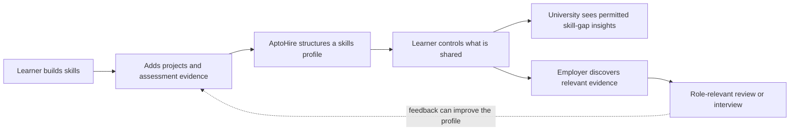

# AptoHire
## AI-first product innovation: make potential easier to see

> **The idea in one line:** AptoHire aims to help universities and employers move beyond résumé-first screening by connecting a learner’s skills to evidence of what they can actually do.

<strong>1. The story: meet a capable student</strong>

Imagine **Aarav**, a student from a college that recruiters rarely visit. He has built useful projects, learned outside the classroom, and can solve real problems—but his résumé looks much like hundreds of others. The recruiter has limited time, so familiar college names and quick filters can shape who gets noticed.

Aarav doesn’t necessarily need another résumé template. He needs a fairer way to **show evidence** of his ability—and a way for the people who know his learning journey to help that evidence travel.

**AptoHire’s product hypothesis:** turn scattered proof—projects, assessments, skills and institutional context—into a structured, shareable skills profile that can help the right people discover and evaluate a candidate.

## 2. What already exists—and where AptoHire can differ

AptoHire is **not** claiming that portfolios, assessments, AI matching or campus hiring are new inventions. Platforms such as urlUnstophttps://unstop.com/, urlHackerRankhttps://www.hackerrank.com/ and urlLinkedInhttps://www.linkedin.com/ already serve important parts of the talent journey. citeturn0search2turn0search3turn0search12

| Existing approach | Value it provides | AptoHire’s proposed angle |
|---|---|---|
| Job and professional networks | Visibility, profiles and opportunities | Make evidence of skills more structured and easier to interpret |
| Coding tests and assessments | Standardized signals for selected skills | Combine assessment results with projects and other evidence, rather than relying on one signal |
| Hackathons and campus hiring platforms | Candidate engagement, competitions and recruitment workflows | Support an ongoing learner profile—not only performance in a single event |
| College placement systems | Institutional coordination and placement activity | Give institutions a clearer view of skills evidence and gaps, subject to appropriate access and consent |

**The innovation is the combination and workflow—not a claim to have invented each component.** These distinctions are product hypotheses to validate against specific competitors and customer needs.

## 3. The product loop

<strong>What makes this useful?</strong>

- **Evidence over adjectives:** connect skill claims to projects, work samples or assessment results where available.
- **A continuing record:** let evidence accumulate as a learner grows, instead of starting from scratch for every opportunity.
- **Consent-aware visibility:** let learners control which profile details are shared; institutional analytics should use appropriate permissions and safeguards.
- **A university-first starting point:** help institutions organize skills evidence and identify learning gaps before attempting to build a large two-sided hiring marketplace.

These are intended product principles; the live product must be tested to confirm which are implemented today.

### The AI-first intelligence layer

AptoHire's AI-first approach is intended to make skills evidence more useful and
easier to interpret across the learner-to-employer journey:

| AI capability | Intended workflow value | Governance |
|---|---|---|
| AI-assisted project assessment | Help evaluate submitted work against defined skill rubrics | Evidence-linked results and human review |
| Skill intelligence and skill graphs | Organise demonstrated capabilities and identify relationships | Explainable skill-level signals |
| AI-supported project recommendations | Suggest practice projects aligned with a learner's current level | Recommendations remain guidance, not guarantees |
| Job-description skill extraction | Structure role requirements into skills that can be compared with candidate evidence | Recruiters retain decision-making responsibility |

**Responsible AI principle: AI proposes; people and policy govern.**
AI should support assessment and discovery, not independently decide a person's
employability. Identity, consent and access permissions remain governed by
explicit rules and user controls.

**Implementation caveat:** These are product capabilities and prototype
workflows, not a claim that every AI feature is production-connected or
independently validated. The repository's mock/demo defaults and project-status
notes should be considered when describing implementation maturity.

## 4. Why it could matter

The opportunity is not “another job portal.” It is a **trust and translation layer** between what learners can do, what institutions teach, and what employers need.

Potential value:
- **For learners:** a clearer way to demonstrate skills beyond degree, college name or résumé wording.
- **For universities:** better visibility into demonstrated skills and possible gaps, using data they are authorized to access.
- **For employers:** a more evidence-rich starting point for screening and interviews—not an automated guarantee that someone is job-ready.

## 5. How we prove the innovation

| Hypothesis to test | Early evidence that would matter |
|---|---|
| Universities have this problem strongly enough to adopt | Interviews with placement teams and academic leaders; written pilot interest |
| Evidence-rich profiles improve screening | Recruiters compare profile-based reviews with résumé-only reviews |
| Students keep profiles current | Activation, evidence completion and repeat-use rates |
| Institutions will pay | A named budget owner, pilot scope and willingness-to-pay discussion |
| The product is fair and trustworthy | Consent tests, access-control checks, feedback and bias monitoring |

<strong>Risks we should acknowledge</strong>

- **Crowded market:** competitors already offer sourcing, assessment and hiring workflows.
- **Cold-start problem:** employers need useful candidates; students need meaningful opportunities.
- **Trust problem:** evidence must be authentic, understandable and relevant to the role.
- **Privacy and fairness:** use data minimization, clear consent, appropriate access controls and human review.
- **Unproven differentiation:** customer interviews and comparative pilots must show that the combined workflow solves a real gap better than existing tools.

## 6. The judge / investor takeaway

> **AptoHire wants to make talent more legible—not simply make résumés more attractive.**

We are not asking judges or investors to believe that a platform alone can solve employability. We are proposing a focused experiment: start with universities, structure credible skills evidence, test whether recruiters find it more useful than résumé-only signals, and scale only when adoption and outcomes support the case.

**Stage honesty:** AptoHire’s proposed differentiation should be treated as a hypothesis until validated through customer research, live pilots and measured outcomes. No placement, hiring, fairness or employability improvement is guaranteed.

---

### Further reading
- urlUnstop — hiring and campus recruitment platformhttps://unstop.com/
- urlHackerRank — technical skills assessmenthttps://www.hackerrank.com/
- urlLinkedIn — professional network and hiring solutionshttps://www.linkedin.com/
- Competitive landscape overview: urlCutshort — Hiring tools landscape in India (2026)https://cutshort.io/hiring-tools-landscape-india
