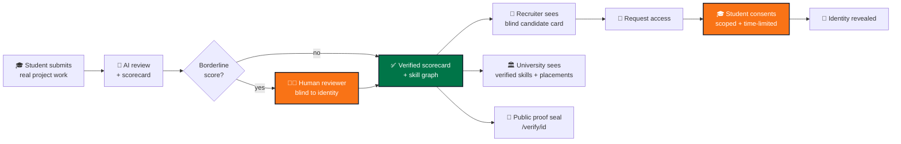
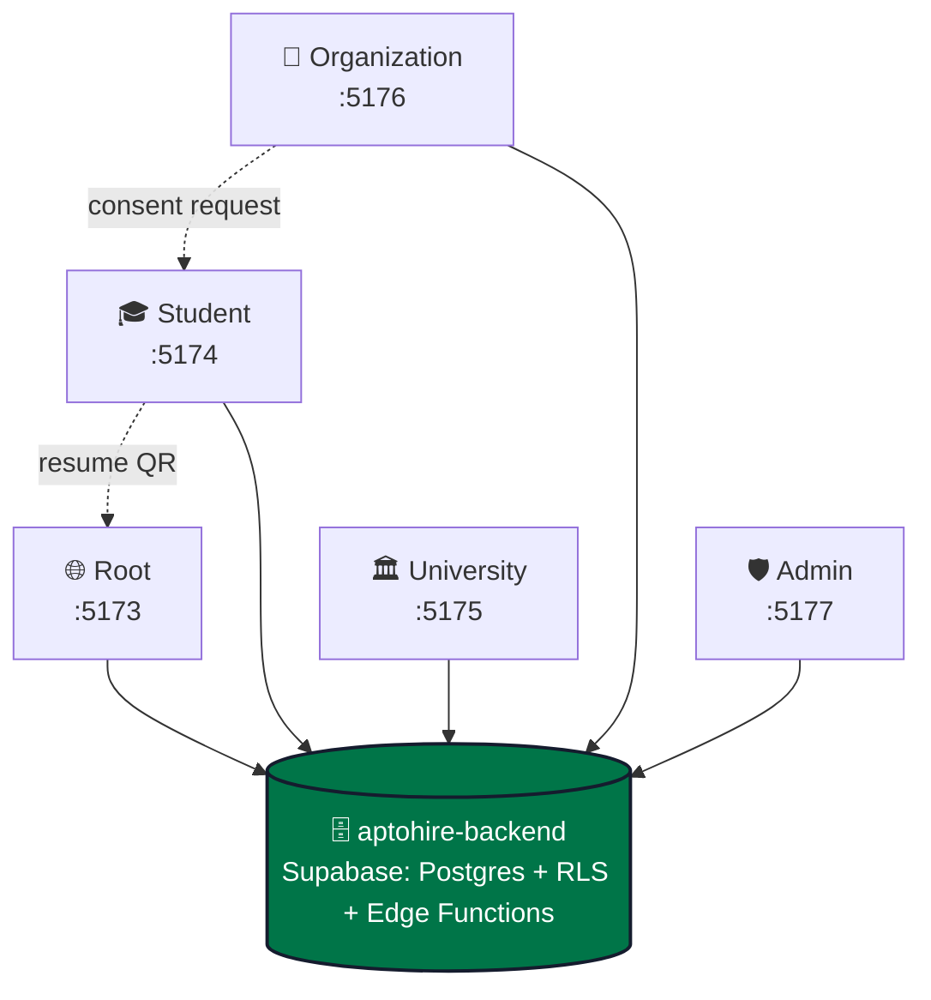
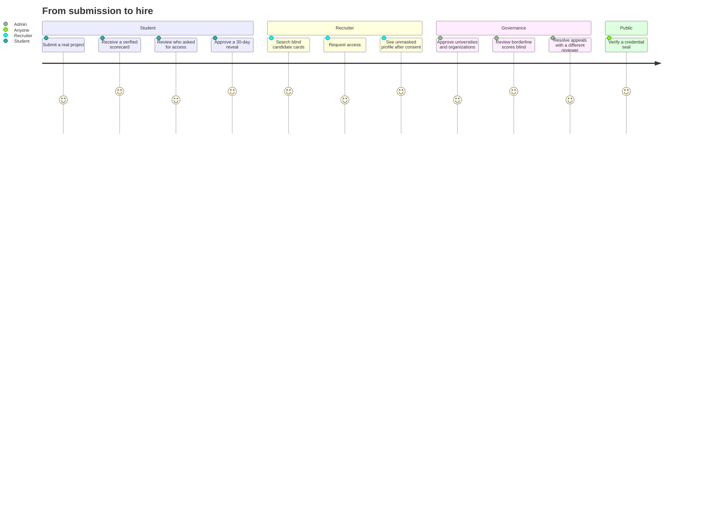
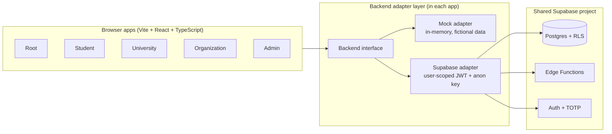

<div align="center">


<b>AI-first, evidence-led hiring.</b>

<p><i>A résumé is a claim. An AI-assisted, human-reviewed scorecard connects skills to proof.</i></p>

[](https://aptohire.vercel.app)
[](https://aptohire-student.vercel.app)
[](https://aptohire-university.vercel.app)
[](https://aptohire-organization.vercel.app)
[](https://aptohire-admin.vercel.app)


**[Submission pack](#-hackathon-submission-pack) · [Problem](#-the-problem) · [AI-first solution](#-our-ai-first-solution) · [Portals](#-five-portals-one-platform) · [Journey](#-end-to-end-journey) · [Features](#-feature-showcase) · [Trust and privacy](#-trust-privacy-and-security-by-design) · [Architecture](#-architecture) · [Status](#-honest-project-status) · [Run](#-run-it-locally) · [Deploy](#-deploy) · [Roadmap](#-roadmap) · [Founders](#-founding-team)**

</div>

---

## 🔗 Quick links

<div align="center">

| | Resource | Link |
|:-:|:--|:--|
| 🌐 | **Root portal** (landing, public verification) | [aptohire.vercel.app](https://aptohire.vercel.app) · [repo](https://github.com/Mansi-Kumawat/aptohire) |
| 🎓 | **Student portal** | [aptohire-student.vercel.app](https://aptohire-student.vercel.app) · [repo](https://github.com/Mansi-Kumawat/aptohire-student) |
| 🏛️ | **University portal** (placement cell) | [aptohire-university.vercel.app](https://aptohire-university.vercel.app) · [repo](https://github.com/Mansi-Kumawat/aptohire-university) |
| 🏢 | **Organization portal** (recruiters) | [aptohire-organization.vercel.app](https://aptohire-organization.vercel.app) · [repo](https://github.com/Mansi-Kumawat/aptohire-organization) |
| 🛡️ | **Admin console** (AptoHire staff) | [aptohire-admin.vercel.app](https://aptohire-admin.vercel.app) · [repo](https://github.com/Mansi-Kumawat/aptohire-admin) |
| 🗄️ | **Shared backend** (Supabase) | `aptohire-backend` *(not part of the five repos; add link when merged)* |
| 🎬 | **Demo video** | [AptoHire Product Film (1080p)](https://github.com/Mansi-Kumawat/Aptohire-submission-repo/blob/main/Pitch%20Deck%20and%20Demo%20Video/Demo_Video/AptoHire_Product_Film_1080p.mp4) |
| 🏆 | **Hackathon submission pack** | [Jump to the pack](#-hackathon-submission-pack) |

</div>

---

## 🏆 Hackathon Submission Pack

Everything a judge or reviewer needs, one click away. These are the actual hackathon deliverables; the live product links are in [Quick links](#-quick-links) above.

<div align="center">

| | Submission | Direct link |
|:-:|:--|:--|
| 💡 | **Idea document** | [Reviewed AptoHire Idea Document](https://github.com/Mansi-Kumawat/Aptohire-submission-repo/blob/main/AI_First_Startup_Hackathon_Journey/Solution_making%28Protected%29/AptoHire_Idea_Document_Reviewed.docx) |
| 📊 | **Pitch deck** | [AptoHire Pitch Deck](https://github.com/Mansi-Kumawat/Aptohire-submission-repo/blob/main/Pitch%20Deck%20and%20Demo%20Video/Pitch_Deck/AptoHire_Pitch_Deck.pptx) |
| 🎬 | **Demo video** | [AptoHire Product Film](https://github.com/Mansi-Kumawat/Aptohire-submission-repo/blob/main/Pitch%20Deck%20and%20Demo%20Video/Demo_Video/AptoHire_Product_Film_1080p.mp4) |
| 🎯 | **Problem statement** | [Problem Statement](https://github.com/Mansi-Kumawat/Aptohire-submission-repo/blob/main/Problem_statement.md) |
| 🚀 | **Product innovation** | [Product Innovation](https://github.com/Mansi-Kumawat/Aptohire-submission-repo/blob/main/Product_Innovation.md) |
| 📈 | **Market analysis** | [Market Potential](https://github.com/Mansi-Kumawat/Aptohire-submission-repo/blob/main/Market_Potential.md) |
| 🏗️ | **Technical documentation** | [System Architecture](https://github.com/Mansi-Kumawat/Aptohire-submission-repo/blob/main/System_Architecture.md) |
| 👥 | **Team execution** | [Team Workflow & Timeline](https://github.com/Mansi-Kumawat/Aptohire-submission-repo/blob/main/AI_First_Startup_Hackathon_Journey/Icode_Team_Workflow/Team_workflow_timeline.md) |

</div>

---

## 💥 The problem

> **Talent is not scarce. Proof is.**

Résumés are self-declared. Degrees and college names stand in for skill. Recruiters cannot verify what a candidate can really do, and universities cannot see how their students' skills line up with real demand.

<table>
<tr>
<td width="25%" valign="top">

### 😟 Student
- Strong work, weak pedigree: **filtered out**
- Skills are **claims**, not proof
- Little feedback on *why* a score is what it is

</td>
<td width="25%" valign="top">

### 🏛️ University
- Placement data is **scattered and manual**
- No view of **verified skills** across a cohort
- No signal on **what the market demands**

</td>
<td width="25%" valign="top">

### 🏢 Recruiter
- Keyword-stuffed PDFs, **no evidence**
- **Name and brand bias** creeps into shortlists
- Hard to trust AI-scored profiles

</td>
<td width="25%" valign="top">

### 🛡️ Platform
- AI scoring needs **human oversight**
- Appeals need a **fair second look**
- Everything needs an **audit trail**

</td>
</tr>
</table>

---

## 💡 Our AI-first solution

AptoHire is an **AI-first, evidence-led talent platform** that helps turn real-world, multi-modal project submissions into structured skill evidence. Its AI-assisted workflow supports project assessment, scorecard generation, skill-graph evaluation, level-appropriate project suggestions and job-description-to-skill structuring. **AI proposes; transparent rules and human oversight govern consequential decisions.** Borderline scores are routed to identity-blind human review, appeals receive an independent second look, and recruiters see blind candidate cards until a student grants scoped, time-limited access. The goal is not to replace human judgement or rank people using an opaque model, but to make demonstrated ability easier to inspect.



### Before vs after

<div align="center">

| | ❌ Traditional hiring | ✅ With AptoHire |
|:--|:--|:--|
| **Unit of trust** | A résumé claim | A verified project scorecard |
| **First impression** | Name, college, employer | Blind card: skills and proof only |
| **Identity** | Visible from the start | Revealed only with student consent, time-limited |
| **Borderline AI scores** | Unchecked | Held for a human reviewer who cannot see identity |
| **Disputes** | None | Appeal tickets, reviewed by a *different* reviewer |
| **Accountability** | Opaque | Append-only audit log |

</div>

---

## 🌐 Five portals, one platform

AptoHire is **five independent web apps** that share **one Supabase database**. Each has its own domain, deployment and session. Database policies (RLS) and server functions are the security boundary; no portal ever holds a privileged key.



<div align="center">

| Portal | Audience | Live app | Source code | Local port | What it does |
|:--|:--|:--|:--|:-:|:--|
| 🌐 **Root** | Everyone | [aptohire.vercel.app](https://aptohire.vercel.app) | [aptohire](https://github.com/Mansi-Kumawat/aptohire) | 5173 | Landing, applications, public credential verification at `/verify/<id>` |
| 🎓 **Student** | Student engineers | [aptohire-student.vercel.app](https://aptohire-student.vercel.app) | [aptohire-student](https://github.com/Mansi-Kumawat/aptohire-student) | 5174 | Projects, submissions, scorecards, skill graph, résumé, sharing and consent |
| 🏛️ **University** | Placement cell (TPO) | [aptohire-university.vercel.app](https://aptohire-university.vercel.app) | [aptohire-university](https://github.com/Mansi-Kumawat/aptohire-university) | 5175 | Roster import, cohorts, verified skills, placements, aggregate skills demand |
| 🏢 **Organization** | Recruiters | [aptohire-organization.vercel.app](https://aptohire-organization.vercel.app) | [aptohire-organization](https://github.com/Mansi-Kumawat/aptohire-organization) | 5176 | Blind candidate search, access requests, consent-based reveal |
| 🛡️ **Admin** | AptoHire staff | [aptohire-admin.vercel.app](https://aptohire-admin.vercel.app) | [aptohire-admin](https://github.com/Mansi-Kumawat/aptohire-admin) | 5177 | Approvals, blind reviews, appeals, AI agent runs, kill switch, audit log |

<sub>Planned custom domains (not live yet): `aptohire.com`, `student.`, `university.`, `organization.` and `admin.aptohire.com`.</sub>

</div>

---

## 🧭 End-to-end journey



**Seven-minute integration test** (works in demo mode across all portals):

1. **Admin** signs in and approves a pending university.
2. **Student** submits a React project and a scorecard is generated.
3. **Recruiter** searches, finds the student's anonymous card, and requests access.
4. **Student** accepts the request for 30 days under *Sharing*.
5. **Recruiter** now sees the unmasked profile.
6. **Root** `/verify/<id>` validates the credential's proof seal.

---

## ✨ Feature showcase

> Status legend: ✅ working in the current prototype (mock or demo mode) · 🧪 partial, needs backend wiring · 🗺️ planned. See [Honest project status](#-honest-project-status).

### 🎓 Student portal

<div align="center">

| | Feature | What it does | Status |
|:-:|:--|:--|:-:|
| 🏆 | **Verified scorecards** | Score and level per skill (for example Proficient, Advanced) with proof rings | ✅ |
| 🕸️ | **Skill graph** | Visual map of verified skills and how they connect | ✅ |
| 📤 | **Project submissions** | Submit real work for multi-modal assessment | ✅ |
| 📄 | **Résumé builder** | Résumé backed by verified scores, with a QR code linking to public verification | ✅ |
| 🔑 | **Sharing and consent** | Approve or decline recruiter access requests for a limited time | ✅ |
| 🧑‍🚀 | **Onboarding flow** | First-time experience for a student with zero submissions | ✅ |
| 📱 | **Responsive UI** | 21 views tested from 360px to 1440px | ✅ |

</div>

### 🏛️ University portal

<div align="center">

| | Feature | What it does | Status |
|:-:|:--|:--|:-:|
| 📥 | **Roster CSV import** | Validated, browser-side column mapping; unmapped columns are dropped before upload | ✅ |
| 👥 | **Cohorts** | Filter by year, program and lifecycle status | ✅ |
| ✅ | **Verified via roster** | Link each student's affiliation to a roster row | ✅ |
| 📈 | **Placements** | Placed, Not placed or Unknown (Unknown is never treated as negative) | ✅ |
| 🔥 | **Unmatched demand** | Job-skill counts and reasons, with no student identities | ✅ |
| 🔒 | **Privacy rules** | No cross-university comparison; no identities in demand views | ✅ |
| 🔌 | **Live Supabase adapter** | User-scoped data access using the staff member's JWT | 🧪 |

</div>

### 🏢 Organization portal

<div align="center">

| | Feature | What it does | Status |
|:-:|:--|:--|:-:|
| 🕶️ | **Blind candidate cards** | Skills and proof only; no identity tables are ever read | ✅ |
| 📨 | **Access-request dialog** | Contact-checked request to a candidate | ✅ |
| ⏳ | **Account states** | Pending approval and inactive subscription views | ✅ |
| 🔑 | **Consent-based reveal** | Name and permitted fields shown only after scoped, time-limited student consent | 🧪 |
| 🔌 | **Supabase adapter and role gates** | Real Auth, role checks, privacy tests | 🗺️ |

</div>

### 🛡️ Admin console

<div align="center">

| | Feature | What it does | Status |
|:-:|:--|:--|:-:|
| 🔐 | **Two-step verification** | TOTP enrolment; gate order is session, role, 2FA, admin pages | ✅ |
| ✅ | **Approvals** | Approve a university (unlocks roster) or an organization (verified badge); rejections need a reason | ✅ |
| 🧑‍⚖️ | **Blind reviews** | Review work and evidence without student identity; confirm or adjust borderline scores | ✅ |
| 🎫 | **Appeal tickets** | Assigned to a *different* reviewer than the one who confirmed the score | ✅ |
| 🤖 | **Agent runs** | Retry failed or timed-out AI runs | ✅ |
| 🛑 | **AI kill switch** | Pauses new AI reviews and project assignments; student drafts remain | ✅ |
| 🧾 | **Audit log** | Append-only record; exports need a fresh authenticator check | ✅ |
| 🚫 | **No impersonation, no public sign-up** | The most privileged surface is deliberately minimal | ✅ |

</div>

### 🌐 Root portal

<div align="center">

| | Feature | What it does | Status |
|:-:|:--|:--|:-:|
| 🧭 | **Landing and sign-in routing** | Sends each role to the right portal | ✅ |
| 📝 | **Applications** | Universities and organizations apply for access | 🧪 |
| 🔐 | **Public verification** | `/verify/<id>` validates a credential's proof seal | 🧪 |

</div>

---

## 🧠 AI-first, human-governed workflow

AptoHire uses AI as an assistance layer across the talent-evidence journey:

- **AI-assisted project assessment:** analyse submitted work against defined skill rubrics and help produce evidence-linked scorecards.
- **Skill intelligence:** organise demonstrated capabilities into a connected skill graph and surface skill-level insights.
- **AI-supported learning pathways:** suggest level-appropriate projects to help students build evidence in areas where they need practice.
- **Job-description intelligence:** structure role descriptions into required skills so that evidence can be compared with role needs.
- **Human oversight:** send borderline or disputed results to a reviewer who is blind to candidate identity; AI output is not the final authority.

> **Responsible-AI principle: AI proposes, people and policy govern.** Identity checks, consent, permissions and access control remain rule-based. The current repository documents a prototype with mock/demo defaults; this positioning does not imply that every AI workflow is production-connected or independently validated.

---

## ⚖️ Trust, privacy and security by design

<div align="center">

| | Principle | In practice |
|:-:|:--|:--|
| 🕶️ | **Blind by default** | Recruiters and reviewers see work, not identity |
| 🔑 | **Consent to reveal** | Identity is shown only after scoped, time-limited student consent |
| 🧑‍⚖️ | **Human in the loop** | Borderline AI scores are held for a human decision |
| ⚖️ | **Fair appeals** | A different reviewer handles every appeal |
| 🧾 | **Auditable** | Admin actions land in an append-only log |
| 🔐 | **Step-up security** | Sensitive admin changes require a fresh authenticator code |
| 🗝️ | **No privileged keys in browsers** | Only the public anon key is used; RLS is the boundary |
| 🧪 | **Fictional demo data** | All people, universities and organizations in mock mode are made up |

</div>

---

## 🏗️ Architecture



<div align="center">

| Layer | Technology |
|:--|:--|
| 🖥️ Frontends | Vite, React 18, TypeScript, Tailwind CSS, TanStack-style query hooks |
| 🔌 Data access | `Backend` interface with a **mock adapter** (default) and a **Supabase adapter**; components never import the Supabase SDK directly |
| 🧰 Student API | Node.js and Express REST server with health checks and CORS, plus Supabase schemas, RLS policies and migrations |
| 🗄️ Database and auth | Supabase (Postgres, Row Level Security, Edge Functions, Auth with TOTP) |
| 🧪 Testing | Vitest (unit and integration), Playwright (responsive end-to-end) |
| ☁️ Deployment | One Vercel project per portal, each with its own `vercel.json` rewrites and security headers |

</div>

### Repository layout (current: five separate repos)

```
aptohire/                  # Root portal       (frontend/, backend/, uploads/, vercel.json)
aptohire-student/          # Student portal    (frontend/ + Express backend/ with supabase/ schemas)
aptohire-university/       # University portal (frontend/, backend/ adapters, docs/, e2e/)
aptohire-organization/     # Organization portal (frontend/, backend/ notes, docs/, public/)
aptohire-admin/            # Admin console     (frontend/, backend/src adapters, docs/, e2e/, scripts/, tests/)
```

> After merging, a monorepo such as `apps/root`, `apps/student`, `apps/university`, `apps/organization`, `apps/admin` and `backend/` (Supabase) works well. See the [Roadmap](#-roadmap).

---

## 📏 Honest project status

> We would rather be exact than impressive.

<div align="center">

| Portal | State today |
|:--|:--|
| 🎓 Student | Most complete: 21 views, mock engine with session persistence, Express API with Supabase schemas, 50 responsive E2E tests |
| 🏛️ University | Full mock-mode flows; Supabase adapter follows a draft contract that still needs checking |
| 🏢 Organization | **UI prototype.** Real Supabase adapter, full Auth and role gates, consent-based reveal and privacy tests are not complete |
| 🛡️ Admin | Mock flows are suitable for an interface demo, not a security certification; backend contract must be validated before real data |
| 🌐 Root | Deployed; documentation for it is still thin (see TODOs) |

</div>

**Important limits:**

- Mock mode uses **fictional data** only. Do **not** use any portal with real candidate data until the shared backend contract is validated.
- The shared backend project (`aptohire-backend`) and its `docs/CONTRACT.md` are **not in these five repos**. Each portal's Supabase adapter must be reconciled against that contract.
- The UI is not an authorization boundary. Real authorization lives in database policies and Edge Functions.

---

## ⚙️ Run it locally

All portals run in **mock mode by default**, so no backend or keys are needed to explore them.

**Prerequisites:** Node.js 20.19+ (LTS) and Git.

<table>
<tr>
<td width="50%" valign="top">

### 🎓 Student (also starts the API)
```bash
cd aptohire-student
npm install
# Frontend  -> http://localhost:5174
cd frontend && npm run dev
# API       -> http://localhost:4000
cd ../backend && npm run dev
```

</td>
<td width="50%" valign="top">

### 🏛️ University / 🏢 Organization / 🛡️ Admin
```bash
cd aptohire-<portal>
npm install
cp .env.example .env.local   # frontend/.env.local for University
npm run dev
# University   -> :5175
# Organization -> :5176
# Admin        -> :5177
```

</td>
</tr>
</table>

### Demo accounts (all fictional, any non-empty password works in mock mode)

<div align="center">

| Portal | Accounts |
|:--|:--|
| 🎓 Student | One-click personas: **Aarav Sharma** (React 72, Proficient), **Avi Verma** (SQL 88, Advanced), **Niya Sen** (Market Analysis 74, Proficient), **Naman Patel** (first-time user) |
| 🏛️ University | `tpo@unia.edu.test` (approved, rich data) · `tpo@unib.edu.test` (approved, smaller) · `tpo@unic.edu.test` (pending; use **Simulate admin approval**) |
| 🏢 Organization | `recruiter@orga.demo.test` through `recruiter@orgd.demo.test` |
| 🛡️ Admin | `admin@demo.aptohire.test`; TOTP code `123456` in mock mode; `reviewer2@demo.aptohire.test` to test the different-reviewer rule |

</div>

### Key commands (University, Organization, Admin)

<div align="center">

| Command | Purpose |
|:--|:--|
| `npm run dev` | Start on the portal's fixed port |
| `npm run typecheck` | Strict TypeScript check |
| `npm run lint` | ESLint (Admin also runs accessibility checks) |
| `npm run test` | Vitest unit tests |
| `npm run build` | Type-check, build and run static security checks |
| `npm run e2e` | Playwright browser tests |
| `npm run db:types` | Generate Supabase types (needs `SUPABASE_PROJECT_REF`) |
| `npm run security:check` | Admin only: scan for secret markers and prohibited copy |

</div>

Student tests: `npm --prefix frontend test`, `npm --prefix backend test`, `npm --prefix frontend run e2e` (50 responsive tests across 5 viewports).

### Connect all portals to one backend

Set these in **every** portal's `.env.local` (local) or Vercel environment (production):

```bash
VITE_USE_MOCKS=false
VITE_SUPABASE_URL=https://your-project.supabase.co
VITE_SUPABASE_ANON_KEY=your-public-anon-key   # public key only
```

Sibling-portal links (for cross-portal buttons):

```bash
VITE_ROOT_URL=https://aptohire.com
VITE_STUDENT_URL=https://student.aptohire.com
VITE_UNIVERSITY_URL=https://university.aptohire.com
VITE_ORGANIZATION_URL=https://organization.aptohire.com
VITE_ADMIN_URL=https://admin.aptohire.com
```

> **Never put a service-role key, secret key or any privileged credential in any portal.**

Also add each portal's production and `http://localhost:<port>/**` URLs under Supabase **Authentication → URL Configuration**, and allow all five origins in the backend's CORS settings.

---

## ☁️ Deploy

Create **one Vercel project per portal** and attach its own domain. Do not combine portals into one project.

<div align="center">

| Setting | Value |
|:--|:--|
| Build command | `npm run build` (Student root deploy: `cd frontend && npm install && npm run build`) |
| Output directory | `frontend/dist` |
| Production env | `VITE_APP_ENV=production`, `VITE_USE_MOCKS=false`, `VITE_DEMO_MODE=false`, public Supabase URL and anon key |
| Never set | `VITE_DEMO_PASSWORD` in production |

</div>

Admin extras: create the first admin manually using the backend's `scripts/create-admin.sql`, enrol TOTP, and confirm server-side authorization before inviting staff. Consider Vercel Deployment Protection or an IP allow-list in front of Admin as an *extra* layer, not a substitute for authentication and 2FA.

---

## 🗺️ Roadmap

<p align="center"></p>

---

## 🚀 Founding Team

AptoHire was built by a three-member founding team combining product vision, technical execution, full-stack development and testing.

<div align="center">

| Founder | Role | Contribution |
|:--|:--|:--|
| **Ravi Prakash** | Founder | Originated the idea and contributed to early product discussions. |
| **[Mansi Kumawat](https://github.com/Mansi-Kumawat)** | Co-founder & Team Lead | Led team coordination, documentation and full-stack development. |
| **Laxminarayan Sahu** | Co-founder | Contributed technical guidance, UI/technology inputs and testing. |

</div>

**Our execution philosophy:** AI-assisted development with human-led product decisions, implementation reviews, testing and continuous iteration.

📌 [View the complete team workflow and execution timeline](https://github.com/Mansi-Kumawat/Aptohire-submission-repo/blob/main/AI_First_Startup_Hackathon_Journey/Icode_Team_Workflow/Team_workflow_timeline.md)

---

## 🤝 Contributing

Open an issue before larger changes. Keep real keys out of commits, keep every portal independent (no cross-portal imports), and keep the **blind-by-default**, **consent-to-reveal** and **human-in-the-loop** principles intact.

## 📄 License

*TODO: add a LICENSE file (for example MIT or Apache-2.0).*

<details>
<summary><b>Keywords</b></summary>

`ai-first-hiring` · `ai-powered-talent-platform` · `ai-assisted-assessment` · `ai-skill-intelligence` · `skills-based-hiring` · `proof-of-skill` · `verified-credentials` · `blind-hiring` · `consent-based-access` · `skill-graph` · `placement-analytics` · `human-in-the-loop` · `responsible-ai` · `audit-trail` · `supabase` · `row-level-security` · `react` · `typescript` · `vite` · `tailwindcss` · `playwright` · `vercel` · `hrtech` · `edtech`

</details>
