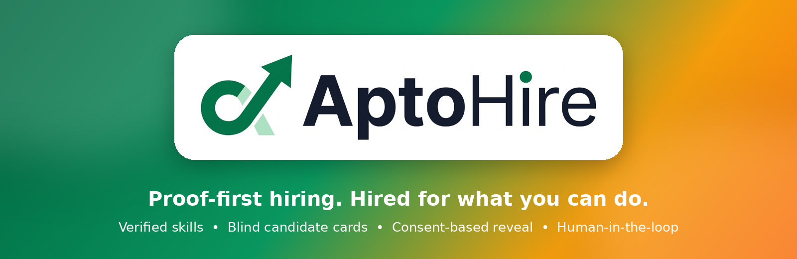
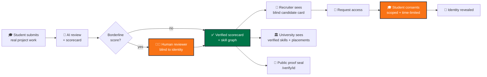
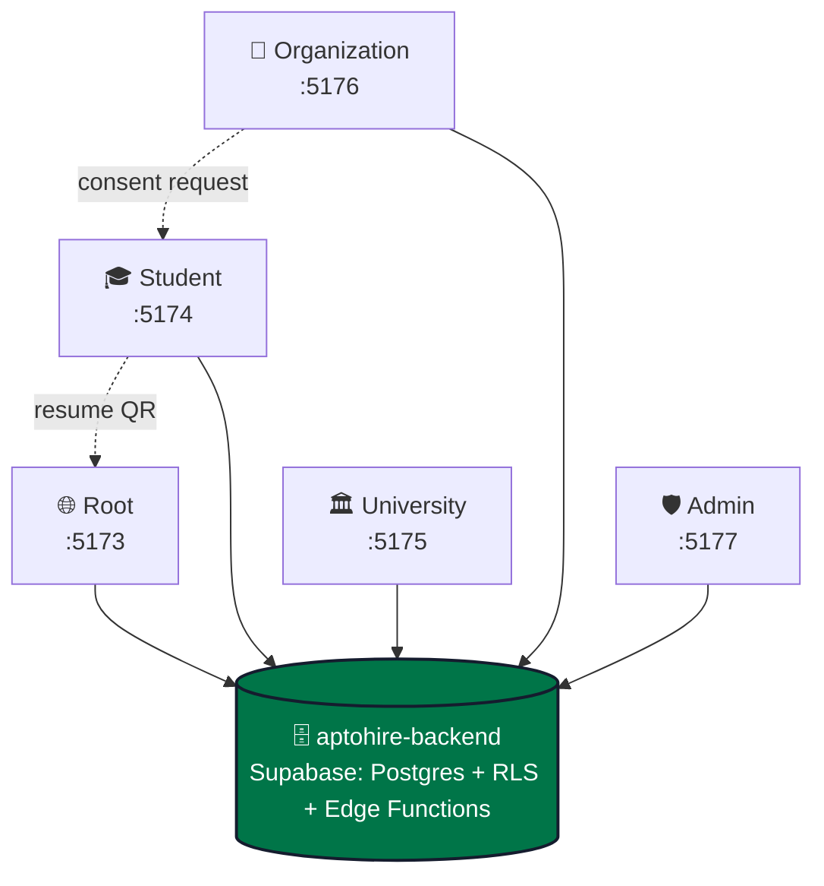
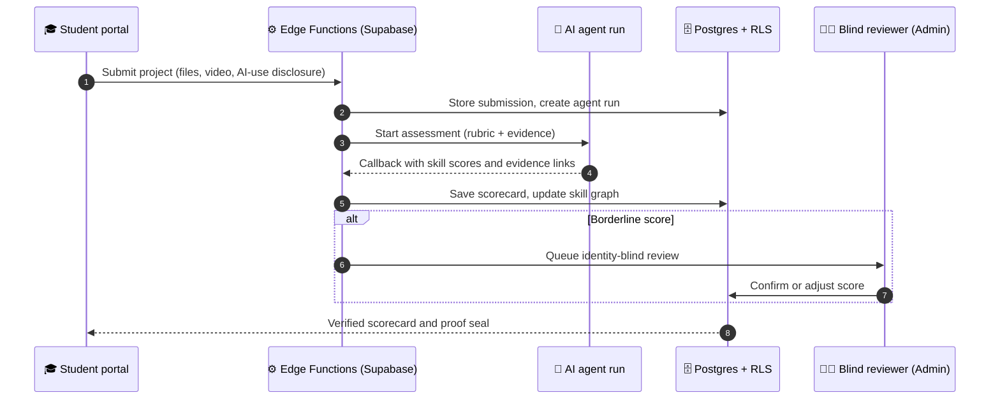
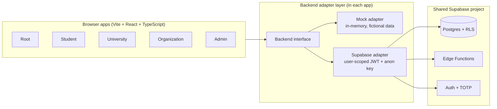
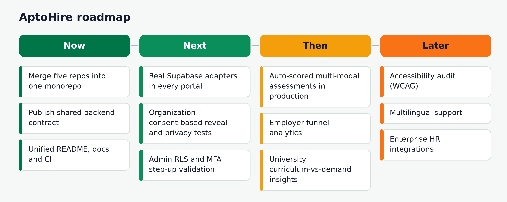

<div align="center">



<b>AI-first, evidence-led hiring.</b>

<p><i>A résumé is a claim. An AI-assisted, human-reviewed scorecard connects skills to proof.</i></p>

[](https://aptohire.vercel.app)
[](https://aptohire-student.vercel.app)
[](https://aptohire-university.vercel.app)
[](https://aptohire-organization.vercel.app)
[](https://aptohire-admin.vercel.app)


**[Submission pack](#-hackathon-submission-pack) · [Problem](#-the-problem) · [AI-first solution](#-our-ai-first-solution) · [Portals](#-five-portals-one-platform) · [Demo](#-product-demo-and-walkthrough) · [Snapshot](#-prototype-engineering-snapshot) · [Features](#-feature-showcase) · [AI engine & architecture](#-ai-engine-and-architecture) · [AI-first build](#-ai-first-development-and-usage-evidence) · [Trust](#-trust-privacy-and-security-by-design) · [Status](#-feature-audit-and-honest-project-status) · [Run](#-run-it-locally) · [Deploy](#-deploy) · [Roadmap](#-roadmap) · [Founders](#-founding-team) · [Contributing](#-contributing-license-and-keywords)**

</div>

---

## 🔗 Quick links

<div align="center">

|    | Resource | Link |
|:--:|:--|:--|
| 🌐 | **Root portal** (landing, public verification) | [aptohire.vercel.app](https://aptohire.vercel.app) · [repo](https://github.com/Mansi-Kumawat/aptohire) |
| 🎓 | **Student portal** | [aptohire-student.vercel.app](https://aptohire-student.vercel.app) · [repo](https://github.com/Mansi-Kumawat/aptohire-student) |
| 🏛️ | **University portal** (placement cell) | [aptohire-university.vercel.app](https://aptohire-university.vercel.app) · [repo](https://github.com/Mansi-Kumawat/aptohire-university) |
| 🏢 | **Organization portal** (recruiters) | [aptohire-organization.vercel.app](https://aptohire-organization.vercel.app) · [repo](https://github.com/Mansi-Kumawat/aptohire-organization) |
| 🛡️ | **Admin console** (AptoHire staff) | [aptohire-admin.vercel.app](https://aptohire-admin.vercel.app) · [repo](https://github.com/Mansi-Kumawat/aptohire-admin) |
| 🗄️ | **Shared backend** (Supabase) | `aptohire-backend` *(not part of the five repos; add link when merged)* |
| 📘 | **Master runbook** (run, demo, deploy) | [MASTER-RUNBOOK.md](MASTER-RUNBOOK.md) |
| 🎬 | **Demo video** | [AptoHire Product Film (1080p)](Pitch%20Deck%20and%20Demo%20Video/Demo_Video/AptoHire_Product_Film_1080p.mp4) |
| 🤖 | **AI usage evidence** | [AI_Utilization folder](AI_Utilization/) · [section below](#-ai-first-development-and-usage-evidence) |

</div>

---

## 🏆 Hackathon Submission Pack

Everything a judge or reviewer needs, one click away. The live product links are in [Quick links](#-quick-links) above.

<div align="center">

| | Submission | Direct link |
|:-:|:--|:--|
| 💡 | **Idea document** | [Reviewed AptoHire Idea Document](AI_First_Startup_Hackathon_Journey/Solution_making%28Protected%29/AptoHire_Idea_Document_Reviewed.docx) |
| 📊 | **Pitch deck** | [AptoHire Pitch Deck](Pitch%20Deck%20and%20Demo%20Video/Pitch_Deck/AptoHire_Pitch_Deck.pptx) |
| 🎬 | **Demo video** | [AptoHire Product Film](Pitch%20Deck%20and%20Demo%20Video/Demo_Video/AptoHire_Product_Film_1080p.mp4) |
| 🎯 | **Problem statement** | [Problem Statement](Problem_statement.md) |
| 🚀 | **Product innovation** | [Product Innovation](Product_Innovation.md) |
| 📈 | **Market analysis** | [Market Potential](Market_Potential.md) |
| 🏗️ | **Technical documentation** | [System Architecture](System_Architecture.md) |
| 👥 | **Team execution** | [Team Workflow & Timeline](AI_First_Startup_Hackathon_Journey/Icode_Team_Workflow/Team_workflow_timeline.md) |
| 🤖 | **AI utilization evidence** | [AI_Utilization](AI_Utilization/) |

</div>

---

## 💥 The problem

> **Talent is not scarce. Proof is.**

Résumés are self-declared. Degrees and college names stand in for skill. Recruiters cannot verify what a candidate can really do, and universities cannot see how their students' skills line up with real demand.

| 😟 Student | 🏛️ University | 🏢 Recruiter | 🛡️ Platform |
|:--|:--|:--|:--|
| Strong work, weak pedigree: **filtered out** | Placement data is **scattered and manual** | Keyword-stuffed PDFs, **no evidence** | AI scoring needs **human oversight** |
| Skills are **claims**, not proof | No view of **verified skills** across a cohort | **Name and brand bias** creeps into shortlists | Appeals need a **fair second look** |
| Little feedback on *why* a score is what it is | No signal on **what the market demands** | Hard to trust AI-scored profiles | Everything needs an **audit trail** |

---

## 💡 Our AI-first solution

AptoHire is an **AI-first, evidence-led talent platform** that helps turn real-world, multi-modal project submissions into structured skill evidence. Its AI-assisted workflow supports project assessment, scorecard generation, skill-graph evaluation, level-appropriate project suggestions and job-description-to-skill structuring. **AI proposes; transparent rules and human oversight govern consequential decisions.** Borderline scores are routed to identity-blind human review, appeals receive an independent second look, and recruiters see blind candidate cards until a student grants scoped, time-limited access.



### Before vs after

| | ❌ Traditional hiring | ✅ With AptoHire |
|:--|:--|:--|
| **Unit of trust** | A résumé claim | A verified project scorecard |
| **First impression** | Name, college, employer | Blind card: skills and proof only |
| **Identity** | Visible from the start | Revealed only with student consent, time-limited |
| **Borderline AI scores** | Unchecked | Held for a human reviewer who cannot see identity |
| **Disputes** | None | Appeal tickets, reviewed by a *different* reviewer |
| **Accountability** | Opaque | Append-only audit log |

---

## 🌐 Five portals, one platform

AptoHire is **five independent web apps** that share **one Supabase database**. Each has its own deployment and session. Database policies (RLS) and server functions are the security boundary; no portal ever holds a privileged key.



<div align="center">

| Portal | Audience | Live app | Source code | Local port | What it does |
|:--|:--|:--|:--|:-:|:--|
| 🌐 **Root** | Everyone | [aptohire.vercel.app](https://aptohire.vercel.app) | [aptohire](https://github.com/Mansi-Kumawat/aptohire) | 5173 | Landing, applications, public credential verification at `/verify/<id>` |
| 🎓 **Student** | Student engineers | [aptohire-student.vercel.app](https://aptohire-student.vercel.app) | [aptohire-student](https://github.com/Mansi-Kumawat/aptohire-student) | 5174 | Projects, submissions, scorecards, skill graph, résumé, sharing and consent |
| 🏛️ **University** | Placement cell (TPO) | [aptohire-university.vercel.app](https://aptohire-university.vercel.app) | [aptohire-university](https://github.com/Mansi-Kumawat/aptohire-university) | 5175 | Roster import, cohorts, verified skills, placements, aggregate skills demand |
| 🏢 **Organization** | Recruiters | [aptohire-organization.vercel.app](https://aptohire-organization.vercel.app) | [aptohire-organization](https://github.com/Mansi-Kumawat/aptohire-organization) | 5176 | Blind candidate search, access requests, consent-based reveal |
| 🛡️ **Admin** | AptoHire staff | [aptohire-admin.vercel.app](https://aptohire-admin.vercel.app) | [aptohire-admin](https://github.com/Mansi-Kumawat/aptohire-admin) | 5177 | Approvals, blind reviews, appeals, AI agent runs, kill switch, audit log |

<sub>Planned custom domains (not live yet): `aptohire.com`, `student.`, `university.`, `organization.` and `admin.aptohire.com`.</sub>

</div>

---

## 🎬 Product demo and walkthrough

<div align="center">

<a href="https://www.youtube.com/watch?v=xQfRwbxzPZ8">
  
</a>

**▶ [Watch the AptoHire Product Film on YouTube](https://www.youtube.com/watch?v=xQfRwbxzPZ8)**

</div>

📁 **[Download the 1080p MP4 from this repository](Pitch%20Deck%20and%20Demo%20Video/Demo_Video/AptoHire_Product_Film_1080p.mp4)** · 🌐 **[Try the live prototype](https://aptohire.vercel.app)**

<!-- TODO: add timestamps per portal once confirmed from the video, e.g. 00:00 Student, 00:45 Organization ... -->

### Eight-step integration walkthrough

Run it in **real mode** with the backend and all five portals up (see [Run it locally](#-run-it-locally)). In **mock mode** portals cannot talk to each other, so use each portal's built-in demo tools (right-hand column).

| # | Portal · account | Do this | You should see | Mock-mode shortcut |
|:-:|:--|:--|:--|:--|
| 1 | **Admin** · Admin 1 | Approvals → open **Uni C** → **Approve** | Consequence text and "University approved." | University → Account → **Simulate admin approval** |
| 2 | **Student** · Aarav | Projects → **Get a project** → React → **Start project** | A project brief with deliverables and rubric preview | n/a |
| 3 | **Student** · Aarav | Fill the submission (video under 3:10, AI-use disclosure) → **Submit project** | Live progress, then "Your React score is ready." with the Proof Ring and evidence chips | Same |
| 4 | **Organization** · Northwind | Jobs → **Frontend Developer (React)** → Candidates | Ranked **anonymous** cards, **no names anywhere** | Same |
| 5 | **Org → Student → Org** | Northwind **Request access**; Aarav → Sharing → **Review request** → scopes + 30 days → **Accept**; back in Northwind → Requests → **View candidate** | Revealed profile with only the shared scopes and the expiry date | Org → Demo tools → **Simulate student response** |
| 6 | **University** · Uni A | Overview → funnel, skills, **Unmatched demand** → open Aarav | Funnel with conversion %, demand as counts, **no student names** | Same |
| 7 | **Student → Root** · Aarav | Scorecard → **Download resume** → scan the QR | Root `/verify/<id>` showing only what Aarav chose to share | Same |
| 8 | **Student** · Avi, then Niya | Avi: Profile → Education → **Confirm** new university. Niya: see the dashed **Unverified** chip | Scores unchanged | Same |
| ➕ | **Admin** · Admin 1 | Reviews → **Naveen's React 52** → Confirm; Tickets as a different reviewer; Settings → **kill switch** | Blind review, consequence preview, banner on every page | Same |

### Screenshots

<!--
TODO (visual): add REAL screenshots from the deployed apps into Assets/screenshots/ and uncomment:

| Student dashboard | University dashboard |
|:--:|:--:|
|  |  |
| Organization (blind discovery) | Admin console |
|  |  |
-->

Open any portal from [Quick links](#-quick-links) and use its one-click demo accounts (see [Demo accounts](#demo-accounts)).

---

## 📊 Prototype engineering snapshot

> These are **engineering facts about the prototype**, not user-impact claims. No user, accuracy or time-saving metrics are claimed because none have been measured yet.

<div align="center">

| 5 | 21 | 50 |
|:-:|:-:|:-:|
| **Portals**<br/>one platform | **Student views**<br/>tested 360px to 1440px | **Playwright E2E tests**<br/>Student, 5 viewports |

</div>

---

## ✨ Feature showcase

> Status legend: ✅ working in the current prototype (mock or demo mode) · 🧪 partial, needs backend wiring · 🗺️ planned. See [Feature audit](#-feature-audit-and-honest-project-status).

### 🎓 Student portal

| | Feature | What it does | Status |
|:-:|:--|:--|:-:|
| 🏆 | **Verified scorecards** | Score and level per skill (for example Proficient, Advanced) with proof rings | ✅ |
| 🕸️ | **Skill graph** | Visual map of verified skills and how they connect | ✅ |
| 📤 | **Project submissions** | Submit real work for multi-modal assessment | ✅ |
| 📄 | **Résumé builder** | Résumé backed by verified scores, with a QR code linking to public verification | ✅ |
| 🔑 | **Sharing and consent** | Approve or decline recruiter access requests for a limited time | ✅ |
| 🧑‍🚀 | **Onboarding flow** | First-time experience for a student with zero submissions | ✅ |
| 📱 | **Responsive UI** | 21 views tested from 360px to 1440px | ✅ |

### 🏛️ University portal

| | Feature | What it does | Status |
|:-:|:--|:--|:-:|
| 📥 | **Roster CSV import** | Validated, browser-side column mapping; unmapped columns are dropped before upload | ✅ |
| 👥 | **Cohorts** | Filter by year, program and lifecycle status | ✅ |
| ✅ | **Verified via roster** | Link each student's affiliation to a roster row | ✅ |
| 📈 | **Placements** | Placed, Not placed or Unknown (Unknown is never treated as negative) | ✅ |
| 🔥 | **Unmatched demand** | Job-skill counts and reasons, with no student identities | ✅ |
| 🔒 | **Privacy rules** | No cross-university comparison; no identities in demand views | ✅ |
| 🔌 | **Live Supabase adapter** | User-scoped data access using the staff member's JWT | 🧪 |

### 🏢 Organization portal

| | Feature | What it does | Status |
|:-:|:--|:--|:-:|
| 🕶️ | **Blind candidate cards** | Skills and proof only; no identity tables are ever read | ✅ |
| 📨 | **Access-request dialog** | Contact-checked request to a candidate | ✅ |
| ⏳ | **Account states** | Pending approval and inactive subscription views | ✅ |
| 🔑 | **Consent-based reveal** | Name and permitted fields shown only after scoped, time-limited student consent | 🧪 |
| 🔌 | **Supabase adapter and role gates** | Real Auth, role checks, privacy tests | 🗺️ |

### 🛡️ Admin console

| | Feature | What it does | Status |
|:-:|:--|:--|:-:|
| 🔐 | **Two-step verification** | TOTP enrolment; gate order is session, role, 2FA, admin pages | ✅ |
| ✅ | **Approvals** | Approve a university (unlocks roster) or an organization (verified badge); rejections need a reason | ✅ |
| 🧑‍⚖️ | **Blind reviews** | Review work and evidence without student identity; confirm or adjust borderline scores | ✅ |
| 🎫 | **Appeal tickets** | Assigned to a *different* reviewer than the one who confirmed the score | ✅ |
| 🤖 | **Agent runs** | Retry failed or timed-out AI runs | ✅ |
| 🛑 | **AI kill switch** | Pauses new AI reviews and project assignments; student drafts remain | ✅ |
| 🧾 | **Audit log** | Append-only record; exports need a fresh authenticator check | ✅ |
| 🚫 | **No impersonation, no public sign-up** | The most privileged surface is deliberately minimal | ✅ |

### 🌐 Root portal

| | Feature | What it does | Status |
|:-:|:--|:--|:-:|
| 🧭 | **Landing and sign-in routing** | Sends each role to the right portal | ✅ |
| 📝 | **Applications** | Universities and organizations apply for access | 🧪 |
| 🔐 | **Public verification** | `/verify/<id>` validates a credential's proof seal | 🧪 |

---

## 🧠 AI engine and architecture

### 🧠 AI engine

AptoHire uses AI as an assistance layer across the talent-evidence journey:

- **AI-assisted project assessment:** analyse submitted work against defined skill rubrics and help produce evidence-linked scorecards.
- **Skill intelligence:** organise demonstrated capabilities into a connected skill graph and surface skill-level insights.
- **AI-supported learning pathways:** suggest level-appropriate projects to build evidence where students need practice.
- **Job-description intelligence:** structure role descriptions into required skills so evidence can be compared with role needs.
- **Human oversight:** borderline or disputed results go to a reviewer who is blind to candidate identity; AI output is not the final authority.

#### How a submission moves through the system



| Aspect | What is true today |
|:--|:--|
| **Execution modes** | `AGENT_MODE=mock` is the documented demo mode: a backend mock agent produces the scorecard (about 15 seconds in the demo). |
| **Control and oversight** | Admin **Agent runs** (retry failed or timed-out runs), **AI kill switch**, blind human review, appeals handled by a different reviewer, append-only audit log. |
| **Server boundary** | AI runs are triggered and received through Supabase Edge Functions; browsers hold only the public anon key. Callbacks are protected by a server-side secret. |
| **Model and provider** | <!-- TODO: fill from the actual implementation: model name(s), provider, which agent handles which route --> *To be documented from the implementation.* |
| **Evaluation and confidence** | <!-- TODO: add real evaluation metrics / confidence method only if measured --> *No accuracy or agreement metrics are claimed yet.* |

> **Responsible-AI principle: AI proposes, people and policy govern.** Identity checks, consent, permissions and access control remain rule-based. This repository documents a prototype with mock/demo defaults; it does not imply that every AI workflow is production-connected or independently validated.

### 🏗️ System architecture



| Layer | Technology |
|:--|:--|
| 🖥️ Frontends | Vite, React 18, TypeScript, Tailwind CSS, TanStack-style query hooks |
| 🔌 Data access | `Backend` interface with a **mock adapter** (default) and a **Supabase adapter**; components never import the Supabase SDK directly |
| 🧰 Student API | Node.js and Express REST server with health checks and CORS, plus Supabase schemas, RLS policies and migrations |
| 🗄️ Database and auth | Supabase (Postgres, Row Level Security, Edge Functions, Auth with TOTP) |
| 🧪 Testing | Vitest (unit and integration), Playwright (responsive end-to-end), Deno (Edge Function tests), RLS security tests |
| ☁️ Deployment | One Vercel project per portal, each with its own `vercel.json` rewrites and security headers |

#### Repository layout

Each portal and the backend is its own folder and Git repository (see the [runbook](MASTER-RUNBOOK.md#1-the-big-picture)):

```
aptohire/
├─ aptohire-backend/        database, security rules, server functions
├─ aptohire-root/           port 5173
├─ aptohire-student/        port 5174
├─ aptohire-university/     port 5175
├─ aptohire-organization/   port 5176
└─ aptohire-admin/          port 5177
```

> The Root portal's published repository is named [`aptohire`](https://github.com/Mansi-Kumawat/aptohire). A monorepo (`apps/*` and `backend/`) is on the [roadmap](#-roadmap).

---

## 🤖 AI-first development and usage evidence

AptoHire was built with AI tools as a core part of the workflow, with humans guiding, reviewing and validating. The evidence lives in the repository:

| Lifecycle stage | Where to look |
|:--|:--|
| Whole-journey record | [AI_First_Startup_Hackathon_Journey](AI_First_Startup_Hackathon_Journey/) |
| AI usage report and tool-specific records | [AI_Utilization](AI_Utilization/) |
| Team workflow and execution timeline | [Team workflow & timeline](AI_First_Startup_Hackathon_Journey/Icode_Team_Workflow/Team_workflow_timeline.md) |
| Build prompts and phase-by-phase process | [MASTER-RUNBOOK.md](MASTER-RUNBOOK.md) (prompts `00` to `05`, one per project) |

<!--
TODO: once the AI_Utilization records are audited, add per-stage rows (ideation, research, design,
development, testing, deployment, pitching) with direct file links, and state a measured
AI-driven-execution percentage ONLY if the records substantiate it.
-->

---

## ⚖️ Trust, privacy and security by design

| | Principle | In practice |
|:-:|:--|:--|
| 🕶️ | **Blind by default** | Recruiters and reviewers see work, not identity |
| 🔑 | **Consent to reveal** | Identity is shown only after scoped, time-limited student consent |
| 🧑‍⚖️ | **Human in the loop** | Borderline AI scores are held for a human decision |
| ⚖️ | **Fair appeals** | A different reviewer handles every appeal |
| 🧾 | **Auditable** | Admin actions land in an append-only log |
| 🔐 | **Step-up security** | Sensitive admin changes require a fresh authenticator code |
| 🗝️ | **No privileged keys in browsers** | Only the public anon key is used; RLS is the boundary |
| 🧪 | **Fictional demo data** | All people, universities and organizations in demos are made up |

---

## 📏 Feature audit and honest project status

> We would rather be exact than impressive.

### By capability

| Capability | Status | Evidence / note |
|:--|:-:|:--|
| Project assessment and scorecard | 🧪 | Works end to end with the **mock agent**; real model integration is not claimed here |
| Skill graph | ✅ | Student portal (prototype) |
| Blind candidate search | ✅ | Organization portal (prototype, mock mode) |
| Consent-based identity reveal | 🧪 | Works in the 8-step walkthrough; real backend wiring and privacy tests incomplete |
| Human review, appeals, kill switch, audit log | ✅ | Admin portal (mock flows) |
| Live backend integration (all portals) | 🧪 | Runbook documents local real mode; each adapter must be reconciled against the backend contract |
| Public credential verification | 🧪 | Root `/verify/<id>` |

### By portal

| Portal | State today |
|:--|:--|
| 🎓 Student | Most complete: 21 views, mock engine with session persistence, Express API with Supabase schemas, 50 responsive E2E tests |
| 🏛️ University | Full mock-mode flows; Supabase adapter follows a draft contract that still needs checking |
| 🏢 Organization | **UI prototype.** Real Supabase adapter, full Auth and role gates, consent-based reveal and privacy tests are not complete |
| 🛡️ Admin | Mock flows are suitable for an interface demo, not a security certification; backend contract must be validated before real data |
| 🌐 Root | Deployed; documentation for it is still thin |

**Important limits**

- Mock mode uses **fictional data** only. Do **not** use any portal with real candidate data until the shared backend contract is validated.
- The shared backend (`aptohire-backend`) and its `CONTRACT.md` are **not in these five repos**. Each portal's Supabase adapter must be reconciled against that contract.
- The UI is not an authorization boundary. Real authorization lives in database policies and Edge Functions.

---

## ⚙️ Run it locally

Follow the **[Master Runbook](MASTER-RUNBOOK.md)** for the complete procedure. Summary:

**Prerequisites:** Node.js LTS, Git. For real mode also: **Docker Desktop** (running), **Supabase CLI** (`npx supabase --version` works), and **Deno** (function tests).

### Option A: Mock mode (fastest, no backend, no keys)

```bash
cd aptohire-<portal>          # root, student, university, organization or admin
npm install
cp .env.example .env.local    # Windows PowerShell: copy .env.example .env.local
npm run dev
```

Student also starts an API: `cd aptohire-student && npm install`, then `cd frontend && npm run dev` (port 5174) and `cd ../backend && npm run dev` (port 4000).

### Option B: Real mode (local Supabase, all portals connected)

**1. Backend**

```bash
cd aptohire-backend
cp .env.example .env.local
# Fill secrets. Use a different random value for each of:
# ID_HASH_PEPPER, ALIAS_PEPPER, RATE_LIMIT_PEPPER, CALLBACK_SECRET
node -e "console.log(require('crypto').randomBytes(32).toString('hex'))"
# Also set: AGENT_MODE=mock, APP_ENV=local, ALLOWED_ORIGINS=http://localhost:5173,...,http://localhost:5177

npm run db:start      # local Supabase (Docker must be running)
npm run db:reset      # migrations + demo data
npm run db:test       # security (RLS) tests
npm run fn:test       # function tests
npm run fn:serve      # keep open: serves Edge Functions
npx supabase status   # shows API URL + anon key (never share the service_role key)
```

Local addresses: API `http://127.0.0.1:54321` · Studio `http://127.0.0.1:54323` · Inbucket (sign-up emails) `http://127.0.0.1:54324`

**2. Every portal** (`.env.local`, then restart `npm run dev` after any change)

```bash
VITE_USE_MOCKS=false
VITE_DEMO_MODE=true
VITE_SUPABASE_URL=http://127.0.0.1:54321
VITE_SUPABASE_ANON_KEY=<anon key from "supabase status">
VITE_DEMO_PASSWORD=<DEMO_PASSWORD from aptohire-backend/.env.example>
```

Sibling-portal links come pre-filled in `.env.example`:

```bash
VITE_ROOT_URL=http://localhost:5173
VITE_STUDENT_URL=http://localhost:5174
VITE_UNIVERSITY_URL=http://localhost:5175
VITE_ORGANIZATION_URL=http://localhost:5176
VITE_ADMIN_URL=http://localhost:5177
```

> **Never put a service-role key, secret key or any privileged credential in any portal.** Each site keeps its own sign-in by design.

**3. Start everything together (macOS / Linux, after `npm run db:start` has run once)**

```bash
npx concurrently -n fn,root,student,uni,org,admin \
  "cd aptohire-backend && npm run fn:serve" \
  "cd aptohire-root && npm run dev" \
  "cd aptohire-student && npm run dev" \
  "cd aptohire-university && npm run dev" \
  "cd aptohire-organization && npm run dev" \
  "cd aptohire-admin && npm run dev"
```

(A Windows PowerShell `start-all.ps1` script is in the [runbook](MASTER-RUNBOOK.md#63-start-all-six-together).)

### Demo accounts

All fictional. Mock mode: any non-empty password. Real mode: the backend's `DEMO_PASSWORD`.

| Portal | Accounts |
|:--|:--|
| 🎓 Student | `aarav@unia.edu.test` (Uni A, React Proficient, 4 consent states) · `naman@demo.aptohire.test` (brand new) · `avi@demo.aptohire.test` (pending university confirmation) · `niya@demo.aptohire.test` (unverified university) |
| 🏛️ University | `tpo@unia.edu.test` (rich data) · `tpo@unib.edu.test` (thin) · `tpo@unic.edu.test` (**pending**) |
| 🏢 Organization | `recruiter@orga.demo.test` (Northwind Labs) · `recruiter@orgb.demo.test` (Brightlane) · `recruiter@orgc.demo.test` (pending) · `recruiter@orgd.demo.test` (subscription inactive) |
| 🛡️ Admin | `admin@demo.aptohire.test` (TOTP `123456` in mock mode) · `reviewer2@demo.aptohire.test`, `reviewer3@demo.aptohire.test` (different-reviewer rule) |

**Admin MFA in real mode has no shortcut:** create the first admin with the backend script `scripts/create-admin.sql`, scan the QR with an authenticator app, and enter the 6-digit code at each sign-in.

### Health checks

```bash
# every portal
npm run typecheck && npm run lint && npm run test && npm run build
# backend
npm run db:reset && npm run db:test && npm run fn:test && npm run fn:check
```

Other portal commands: `npm run e2e` (Playwright), `npm run db:types` (needs `SUPABASE_PROJECT_REF`), `npm run security:check` (Admin only). Student tests: `npm --prefix frontend test`, `npm --prefix backend test`, `npm --prefix frontend run e2e` (50 responsive tests across 5 viewports).

Before any demo, confirm: org candidate pages show **no** names, emails, photos or university names before consent; University demand views show counts only; Admin review screens show no identity; no page shows a key, password or token. Troubleshooting table: [runbook section 11](MASTER-RUNBOOK.md#11-troubleshooting).

---

## ☁️ Deploy

> **Run these steps yourself.** AI tools must not run `db push`, `functions deploy` or `secrets set` against a real project. Order matters (full detail: [runbook section 10](MASTER-RUNBOOK.md#10-putting-it-online-do-this-after-the-local-demo-works)).

1. **Supabase project:** create it (free tier is fine for a demo); note project ref, URL and anon key. Keep `service_role` secret.
2. **Dashboard settings:** Authentication → URL Configuration (add all five site URLs and the localhost ones); email confirmation on; password minimum length 10; TOTP MFA enabled; email sending configured; unused APIs off; storage limits checked.
3. **Push the database** (from `aptohire-backend/`):
   ```bash
   npx supabase login
   npx supabase link --project-ref <your-project-ref>
   npx supabase db push
   ```
4. **Function secrets and functions** (secrets from an uncommitted file):
   ```bash
   npx supabase secrets set --env-file .env.production.local
   npx supabase functions deploy
   ```
   Use `APP_ENV=demo` (or `production` for a real launch, which disables seed/reset), new random peppers, and `ALLOWED_ORIGINS` listing your five real URLs.
5. **Demo data (demo project only):** run the seed in the SQL Editor. **Never seed production.**
6. **First admin:** run `scripts/create-admin.sql`, then enrol the authenticator.
7. **Vercel:** create **five separate projects**, one per portal. Set each project's variables, then attach domains.

   | Setting | Value |
   |:--|:--|
   | Build command | `npm run build` (Student root deploy: `cd frontend && npm install && npm run build`) |
   | Output directory | `frontend/dist` |
   | Production env | `VITE_APP_ENV=production`, `VITE_USE_MOCKS=false`, `VITE_DEMO_MODE=false` for a real launch, public Supabase URL and anon key |
   | Never set | `VITE_DEMO_PASSWORD` in production |
8. **Smoke test** every site over HTTPS, then run the [8-step walkthrough](#eight-step-integration-walkthrough) on the live URLs.
9. **Later:** run your `Security.md` audit against the repos. Vercel Hobby is for non-commercial use; move to a paid plan before charging money or running a company pilot. Free Supabase projects pause after about a week of inactivity.

Admin extra: don't advertise the admin address; consider Vercel Deployment Protection or an IP allow-list as an *extra* layer, never a substitute for authentication and 2FA.

---

## 🗺️ Roadmap

<p align="center"></p>

---

## 🚀 Founding Team

AptoHire was built by a three-member founding team combining product vision, technical execution, full-stack development and testing.

<div align="center">
<table>
  <tr>
    <td align="center" width="33%">
      <a href="https://github.com/raviprakashsinghk-19108"></a>
      <br><b>Ravi Prakash</b><br><sub><b>Founder</b></sub><br><br>
      Defined the product idea and its trust model, designed the student lifecycle, and leads user research and outreach.<br><br>
      <a href="https://github.com/raviprakashsinghk-19108"></a>
      <a href="https://www.linkedin.com/in/ravi-prakash-singh-kushwaha-348446426/"></a>
    </td>
    <td align="center" width="33%">
      <a href="https://github.com/Mansi-Kumawat"></a>
      <br><b>Mansi Kumawat</b><br><sub><b>Co-founder &amp; Team Lead</b></sub><br><br>
      Led team coordination, documentation and full-stack development.<br><br>
      <a href="https://github.com/Mansi-Kumawat"></a>
      <a href="https://www.linkedin.com/in/mansi-kumawat00"></a>
    </td>
    <td align="center" width="33%">
      <a href="https://github.com/LAXMINARAYAN24"></a>
      <br><b>Laxminarayan Sahu</b><br><sub><b>Co-founder</b></sub><br><br>
      Contributed technical guidance, UI/technology inputs and testing.<br><br>
      <a href="https://github.com/LAXMINARAYAN24"></a>
      <a href="https://www.linkedin.com/in/laxminarayan-sahu-49294227b/"></a>
    </td>
  </tr>
</table>
</div>

**Our execution philosophy:** AI-assisted development with human-led product decisions, implementation reviews, testing and continuous iteration.

📌 [View the complete team workflow and execution timeline](AI_First_Startup_Hackathon_Journey/Icode_Team_Workflow/Team_workflow_timeline.md)

---

## 🤝 Contributing, license and keywords

### Contributing

Open an issue before larger changes. Keep real keys out of commits (only `.env.example` is committed), never edit an applied database migration (add a new one), keep every portal independent (no cross-portal imports), and keep the **blind-by-default**, **consent-to-reveal** and **human-in-the-loop** principles intact.

### License

*TODO: add a LICENSE file (for example MIT or Apache-2.0).*

### Keywords

<details>
<summary><b>Keywords</b></summary>

`ai-first-hiring` · `ai-powered-talent-platform` · `ai-assisted-assessment` · `ai-skill-intelligence` · `skills-based-hiring` · `proof-of-skill` · `verified-credentials` · `blind-hiring` · `consent-based-access` · `skill-graph` · `placement-analytics` · `human-in-the-loop` · `responsible-ai` · `audit-trail` · `supabase` · `row-level-security` · `react` · `typescript` · `vite` · `tailwindcss` · `playwright` · `vercel` · `hrtech` · `edtech`

</details>
