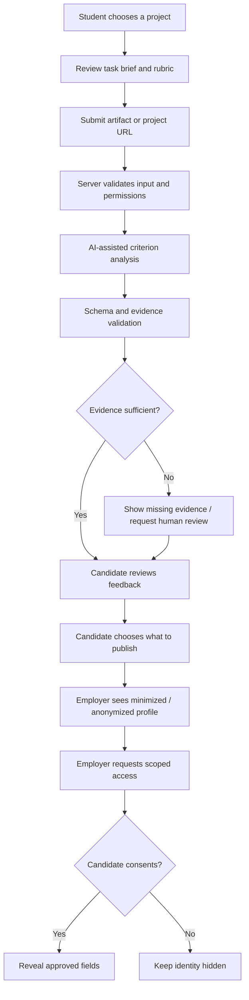

# AptoHire — Proof of Concept & Prototype Specifications

> **Purpose:** Define a testable end-to-end demonstration of evidence-backed skill profiles and consent-first talent discovery. This document specifies the PoC; it does not certify that every described capability is already live.

**Product:** AptoHire · **Site:** https://aptohire.vercel.app  
**Related documents:** [Problem Statement](01_Problem_Statement_and_Hypothesis.pdf) · [UVP](02_UVP_and_Secret_Sauce.pdf) · [Feasibility](03_Feasibility_Report.pdf) · [Customer Validation](05_Customer_Validation_and_Interview_Insights.pdf)

## 1. PoC question

Can AptoHire turn a project submission into a transparent, evidence-linked skill profile and use it for anonymized, consent-based discovery?

## 2. End-to-end user flow

## 3. Minimum demo sequence

| Step | Actor | Expected behavior | Pass condition |
|---|---|---|---|
| 1 | Student | Selects a project and sees rubric before submission | Criteria visible in advance |
| 2 | Student | Submits an artifact or project URL | Input validated safely |
| 3 | System | Produces criterion-level feedback | Each claim has evidence or says evidence is missing |
| 4 | Student | Reviews or appeals result | Status and next step visible |
| 5 | Student | Publishes selected proof fields | Only approved fields become visible |
| 6 | Employer | Searches relevant profiles | Identity unavailable before consent |
| 7 | Employer | Requests access | Request is scoped and auditable |
| 8 | Student | Accepts or declines | No unauthorized identity reveal |
| 9 | University | Views aggregate skills insight | Small-cohort privacy and data caveats respected |

## 4. AI assessment contract

### Suggested input fields
- `submission_id`
- `skill_family`
- `rubric_id` and `rubric_version`
- sanitized artifact or project URL
- evidence metadata
- consent state and permitted analysis scope

### Suggested output fields
- `submission_id`
- `provider` and `model_version`
- `rubric_version`
- per-criterion score/band
- evidence references
- rationale and uncertainty
- missing evidence
- integrity concerns
- `human_review_required`
- timestamp

### Validation rules
1. Reject invalid schemas, out-of-range scores and unknown evidence references.
2. No score should be treated as verified without evidence and the applicable review process.
3. AI must not grant permissions, reveal identity or independently authorize access.
4. Submitted files are **untrusted data**, not instructions to the model or tools.
5. Store enough audit metadata to investigate errors while minimizing raw-data retention.

## 5. Illustrative rubric — frontend project

| Criterion | Observable evidence | Proposed weight |
|---|---|---:|
| Functional correctness | Core flows meet acceptance criteria; reproducible demo/tests | 30% |
| Code structure | Readable logic, components/state, error handling | 20% |
| Accessibility and responsiveness | Semantic structure, keyboard basics, responsive layout | 15% |
| Data/API handling | Validation, loading/error states, no exposed secrets | 15% |
| Testing and debugging | Relevant tests and edge cases | 10% |
| Reasoning and ownership | Can explain decisions using artifact evidence | 10% |

> Weights are illustrative and unvalidated. Do not use them for consequential hiring decisions until reliability, validity, accessibility and fairness are tested.

## 6. Acceptance tests

| ID | Test | Expected result |
|---|---|---|
| POC-01 | Valid project URL submitted | Submission queued |
| POC-02 | Unsupported or oversized upload | Safe rejection and clear message |
| POC-03 | AI score has no evidence references | Validation fails; no verified badge |
| POC-04 | AI provider unavailable | Recoverable error or explicitly labelled demo fallback |
| POC-05 | Employer requests identity before consent | Denied at API/database layer |
| POC-06 | Student declines/revokes access | Identity remains hidden or access expires according to policy |
| POC-07 | Student appeals score | Review queue and visible status |
| POC-08 | README contains prompt injection | Treated as untrusted content, not instructions |
| POC-09 | Tenant A requests Tenant B data | Request denied |
| POC-10 | Public verification URL opened | Only user-approved public fields appear |

## 7. Demo narrative for judges (5–7 minutes)

1. Open with the founder-shared CV anecdote; identify it as an anecdote, not a statistic.
2. Show a student reviewing the rubric before submission.
3. Show evidence-linked feedback, uncertainty and missing evidence—not just a score.
4. Switch to employer discovery and inspect anonymized profiles.
5. Request identity access; show the student's consent decision.
6. Show a university-level aggregate insight and state the university-first customer hypothesis.
7. Close with the actual AI/workflow path, safeguards, current limitations and next validation milestone.

## 8. Claims checklist

| Public claim | Evidence required |
|---|---|
| “AI evaluates submissions” | Trace of a real AI invocation; label mock mode clearly |
| “Skills are verified” | Versioned rubric, evidence links, review policy and audit trail |
| “Bias-aware” | Safeguards plus measured evaluation; design intent alone is insufficient |
| “Saves recruiter time” | Measured comparison against a baseline workflow |
| “Secure” | Threat model, tested access policies, secret handling and suitable security checks |

## 9. Demo-readiness checklist

- [ ] Critical path works from submission to profile sharing.
- [ ] Mock data and mock AI output are visibly labelled.
- [ ] No provider keys or secrets are exposed to the browser.
- [ ] Identity remains hidden before explicit authorization.
- [ ] Errors, timeouts and unavailable-provider states are handled.
- [ ] Sample assessment results can be traced to evidence and rubric version.
- [ ] No real candidate personal data is used in public demos without proper authorization.
