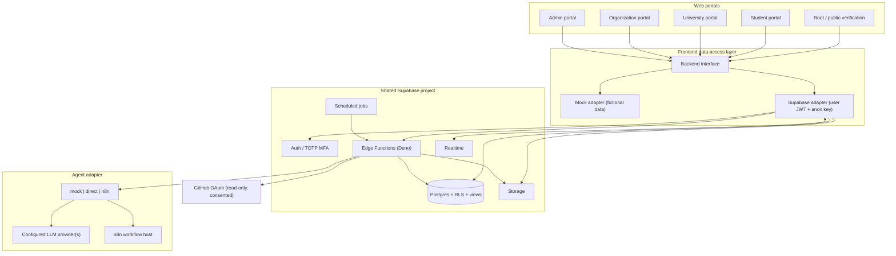
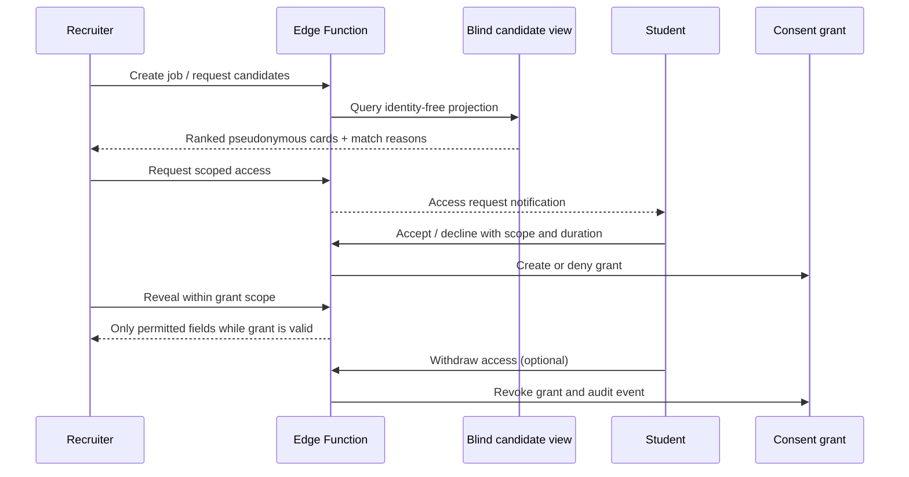

# AptoHire — System Architecture & Technical Specifications
**Version:** 1.0 · **Date:** 30 October 2026 · **Status:** Prototype / demo specification

> This document summarizes the supplied architecture and frozen portal contracts. It is not proof that all described services or controls are deployed. Preserve the exact contracts in `FROZEN-CONTRACTS.md`; treat any change as a coordinated versioned change.

## Navigation
- [1. System context](#1-system-context)
- [2. Portals and trust boundaries](#2-portals-and-trust-boundaries)
- [3. Runtime architecture](#3-runtime-architecture)
- [4. Data and access principles](#4-data-and-access-principles)
- [5. AI execution model](#5-ai-execution-model)
- [6. Security controls](#6-security-controls)
- [7. Deployment and environments](#7-deployment-and-environments)
- [8. Failure handling and observability](#8-failure-handling-and-observability)
- [9. Architecture decisions and open items](#9-architecture-decisions-and-open-items)

## 1. System context

AptoHire is a prototype skill-verification and hiring platform. Student work is assessed into evidence-linked skill scorecards; organizations browse anonymized candidate projections and request consent before identity is revealed; universities see their own student and cohort information; admins govern approvals, borderline reviews and appeals.

### Design principles
1. **One person, durable profile, multiple affiliations.** Do not make a university login the identity anchor.
2. **Database is the security boundary.** UI visibility is not authorization.
3. **Blind by default.** Candidate discovery must not query identity-bearing fields.
4. **Consent is explicit, scoped, time-limited and withdrawable.**
5. **AI proposes; deterministic code decides.** AI does not decide authorization, consent, identity or final workflow state.
6. **Fallbacks are first-class.** `mock`, `direct` and `n8n` execution modes allow graceful degradation.
7. **Prototype honesty.** Mock data is fictional; mock/demo operation is not production validation.

## 2. Portals and trust boundaries

| Portal | Host in design | Actor | Boundary |
|---|---|---|---|
| Root | `aptohire.com` | Anonymous/public visitor | Anonymous access limited to public credential verification and institution/organization application submission. |
| Student | `student.aptohire.com` | Student JWT | Own profile, projects, submissions, scorecard, profile proposals and consent decisions. |
| University | `university.aptohire.com` | University staff JWT | Own university, roster and permitted student analytics. |
| Organization | `organization.aptohire.com` | Approved recruiter JWT | Jobs, blind candidate projections and access requests; no direct identity-table access. |
| Admin | `admin.aptohire.com` | Admin JWT + MFA | Approval, review, appeal and platform-governance operations. |

The design sources describe both an original single Vite/React app with hostname-based portal selection and five separately deployed portal projects. The README says the current setup is five separate repositories; the PRD/architecture also describe one codebase serving five hosts. Treat deployment topology as a migration/implementation decision: do not assume a monorepo or a single deployment without repository audit.

## 3. Runtime architecture

### Component responsibilities

| Component | Responsibility | Important boundary |
|---|---|---|
| Portal UI | Present workflows and validated states | Not an authorization boundary |
| Backend interface | Decouple components from mock and Supabase adapters | UI should not import Supabase SDK throughout components |
| Supabase Auth | Identity session and MFA assurance | Role assignment is controlled server-side |
| Postgres + RLS | Durable data, tenant scoping, policy enforcement, blind projections | Policies must deny unauthorized reads/writes even if UI is bypassed |
| Storage | Evidence files, videos, documents, resumes and roster uploads | Private by default; use short-lived signed URLs and scoped policies |
| Edge Functions | Validated workflow commands, integrations, rate limiting and audit | Authenticate/authorize explicitly; validate with Zod; do not rely on CORS |
| Agent adapter | Deterministic mock, direct LLM, or n8n workflow | Schema validation, quota/kill switch and safe fallback |
| Realtime/cron | Updates and scheduled workflows | Subscribe only to authorized data; scheduled actions need idempotency |

## 4. Data and access principles

The source documents define the domain entities and views in the companion architecture and backend prompts. At a conceptual level, the model separates:
- `profiles` and role assignment;
- durable person/student identity from university affiliations and roster entries;
- project templates, assignments, submissions, audits, criteria, evidence and skill records;
- organizations, jobs, anonymized candidate projections and consent/access requests;
- university roster imports, placement status and analytics;
- applications, support tickets, appeals, admin audit events and application configuration.

Do not treat this list as a complete schema migration. The authoritative column definitions, foreign keys, constraints and policies remain in the source architecture and backend prompts.

### Access matrix (high-level)

| Actor | Allowed scope | Explicit restriction |
|---|---|---|
| Anonymous visitor | Public credential verification; submit institution/organization application | No authenticated data browsing or account creation through application form |
| Student | Own profile, submissions, scorecard, proposals, access requests and own export/delete workflow | Cannot self-assign role or access another student's private record |
| University | Own institution and its permitted roster/student analytics | No other university's private student records |
| Organization | Own jobs, anonymized candidate cards, scoped consent state | No direct identity-table reads; reveal only via authorized consent path |
| Admin | Approved governance actions under elevated MFA assurance | MFA (`aal2`) required for admin functions; actions audited |

### Blind matching flow

## 5. AI execution model

### Modes
- **`mock`** — deterministic, fictional, repeatable output for demos and tests.
- **`direct`** — Edge Function invokes a configured model provider.
- **`n8n`** — Edge Function calls a workflow via authenticated, signed request and receives a validated callback.

### Expected workflow
1. Validate the input and required evidence.
2. Enforce quota, kill switch and request ownership.
3. Prepare a minimum-necessary payload.
4. Execute selected agent mode.
5. Parse output against the declared schema.
6. Persist evidence references, score rationale, confidence and audit status.
7. Route borderline outcomes to human review.
8. Return status without exposing provider secrets or raw internal errors.

### AI governance rules
- AI output is advisory; application rules determine identity, consent, permissions and verification status.
- Preserve evidence references so a score can be inspected.
- Do not invent evidence, transcripts or skills absent from the submitted material.
- Provider failure, malformed JSON, timeout and quota exhaustion must produce defined failure/retry states.
- Do not send secrets, full repositories or unnecessary personal data to providers.
- Maintain a human appeal path and avoid presenting a score as an infallible or objective measure.

## 6. Security controls

1. **RLS on every exposed table/view**, plus explicit grants and function authorization.
2. **No service-role or privileged keys in browser bundles.** Browser uses the public anon key and signed-in user's JWT.
3. **Identity isolation:** organizations cannot directly query identity tables; a single audited reveal path joins identity only after consent.
4. **Consent grant:** scope allow-list (`profile`, `scorecard`, `projects`, `contact`), expiry, withdrawal and audit history.
5. **Admin step-up:** admin Edge Functions require `aal2`; MFA-required errors are handled as a controlled state.
6. **Input validation:** Zod schemas and bounded fields; exact frozen response shapes and error codes.
7. **Rate limits and idempotency:** public endpoints and expensive AI actions protected; public application uses `Idempotency-Key`.
8. **Data minimization:** roster import client maps only canonical fields and drops unmapped columns before upload; student ID numbers are never logged or placed in URLs.
9. **Storage:** private buckets, scoped policies and expiring signed URLs; validate size/type and access before issuing URLs.
10. **Auditability:** append-only admin/audit records; sensitive reveal, approval, appeal and policy changes recorded.
11. **Safe errors:** stable error code and calm user-facing copy; never render raw provider/database errors.
12. **Testing:** negative tests for cross-tenant reads, anonymous misuse, role escalation, expired/revoked grants and MFA bypass.

## 7. Deployment and environments

| Environment | Data | External calls | Usage |
|---|---|---|---|
| Local/mock | Fictional seed data | None required | UI and deterministic workflow development |
| Integration/staging | Synthetic data only | Controlled sandbox providers | Contract, RLS and end-to-end testing |
| Production (future gate) | Real data only after approvals | Reviewed provider integrations | Requires security/privacy review and operational readiness |

The source README describes Node.js 20.19+ and mock mode as the default for the portals. Deployment is described as Vercel-hosted portal projects, with Supabase for auth/database/storage/functions. Confirm actual deployed configuration separately.

## 8. Failure handling and observability

- Use stable errors from the frozen contracts, including `VALIDATION_FAILED`, `UNAUTHENTICATED`, `FORBIDDEN`, `NOT_FOUND`, `CONFLICT`, `RATE_LIMITED`, `QUOTA_EXCEEDED`, `KILL_SWITCH`, `SERVICE_UNAVAILABLE`, `SUBSCRIPTION_INACTIVE`, `NO_TEMPLATE`, `VIDEO_REQUIRED`, `VIDEO_TOO_LONG`, `MISSING_SKILLS`, `GRANT_EXPIRED` and `MFA_REQUIRED`.
- Track correlation/request IDs, workflow state transitions, quota/rate-limit decisions, audit-run mode, duration, outcome and safe failure category.
- Never log passwords, raw student IDs, JWTs, secrets, full uploaded evidence or sensitive identity payloads.
- Metrics should include submission-to-scorecard latency, audit failure/retry rate, evidence coverage, borderline and appeal rates, consent acceptance/withdrawal, import validation outcomes, unauthorized access denials and provider cost/usage.
- Provide operator kill switch for AI and rate-limited public endpoints; document recovery steps.

## 9. Architecture decisions and open items

| Decision | Current source-backed position | Required follow-up |
|---|---|---|
| Portal topology | PRD describes one codebase / host routing; README describes five current repositories | Audit repos and decide target deployment model without breaking existing host contracts |
| Backend readiness | Shared backend contract project is separately specified; README says contract must be reconciled | Audit actual migrations/functions/adapters before calling it production-ready |
| Matching | Structured + vector matching; candidate cards anonymized | Confirm feature parity, quality evaluation and privacy tests |
| Scoring | Scores above 50 are described as verified in PRD; pass/borderline values come from `app_config` per backend prompt | Define and test exact boundaries from config; avoid hard-coded threshold drift |
| AI providers | Source mentions Gemini Flash-class, Groq and OpenRouter options; adapter mode is mock/direct/n8n | Confirm current configured providers and secret management |
| LinkedIn sync | Export upload, not a guaranteed live LinkedIn API integration | Keep explicit consent and user review of profile proposals |
| Production readiness | Prototype/demo only | Security review, privacy/legal review, backups, monitoring, incident response and operational SLOs |

## Source files used
- `prd.md`
- `features.md`
- `architecture.md`
- `agent.md`
- `FROZEN-CONTRACTS.md`
- backend and backend-delta prompts

These sources define intended behavior. This document does not claim the running product has been tested or that all requirements are implemented.
